# Figures and tables for review (Step 2)

Generated by `paper/scripts/make_assets.py`; every number comes from `results/` (see `numbers.tex` and `check_numbers.py`). Captions are drafts. Previews are PNG; the paper uses the PDF (charts) or 300-dpi PNG (image figures).

## Main figures

### fig_pipeline
**Study design.** Each 2048 × 2048 FIVES image is contrast-enhanced (CLAHE) and passed to one of four model families. All probability maps are enlarged to 2048 by bilinear interpolation, thresholded at a value chosen on the validation set, and scored against the original masks inside a field-of-view (FOV) mask. Oracle-prompted SAM uses prompts from each image's own ground truth and is reported separately. LoRA: low-rank adaptation; BCE: binary cross-entropy; P, R: precision, recall; NSD: normalized surface Dice.

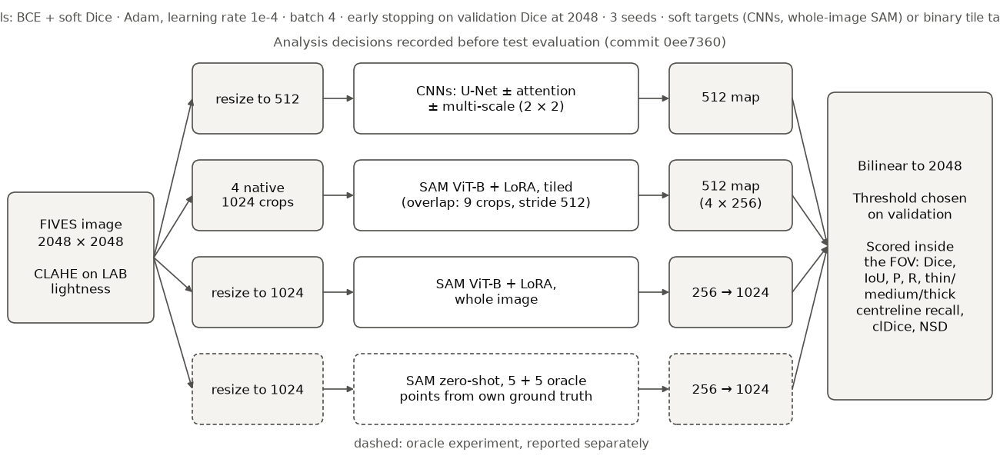

### fig_audit_raster
**Data audit examples.** (A) Two byte-identical training images with different masks: 512 × 512 native-resolution window with the most disagreement (white box), chosen automatically (grey: vessel in both masks; orange, blue: vessel in one mask only). (B) One of 2 training masks with no vessel pixels; inset: the same image with its green channel contrast-stretched inside the eye (outside set to black), in which the optic disc is visible but the vessels barely are. (C) A training and a test image of the same eye, with their masks overlaid (colours as in A). (D) A mask with an annotation line along the image border, outside the eye (orange, thickened for visibility), and the fitted FOV boundary (black). In every image panel the area outside the FOV is pixelated, so burned-in text markings are not legible.

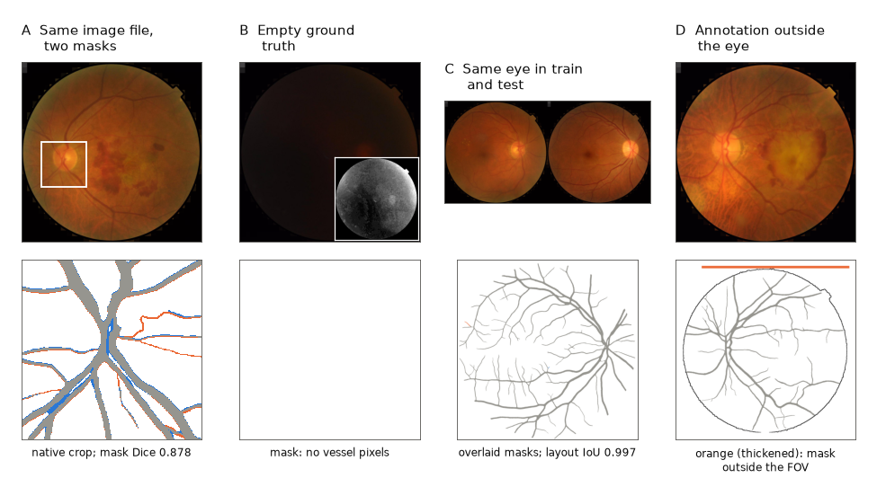

### fig_threshold
**Thin-vessel recall against the threshold (test set).** Centreline recall of thin vessels (radius < 3 px at 2048) for thresholds 0.05–0.95. Lines: mean over 3 training seeds of each seed's mean over the 200 test images; bands: range across seeds. (A) The four CNNs. (B) Fine-tuned SAM with U-Net as reference; the overlapping-tile curve (dashed, hollow markers) uses the same three models as the tiled curve.

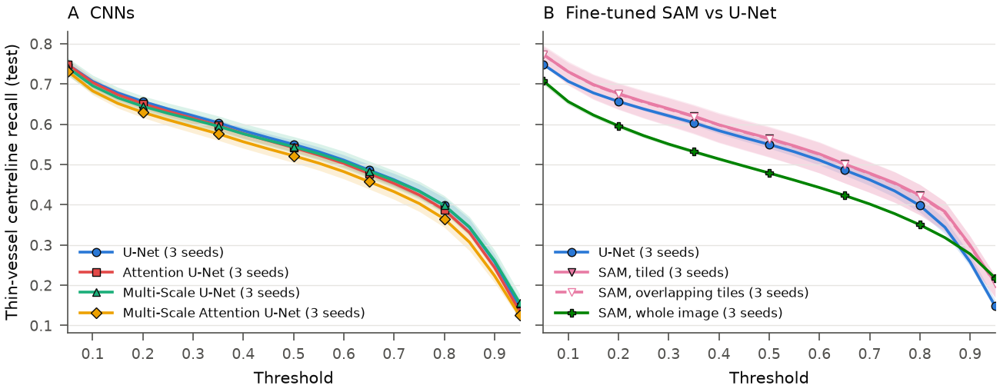

### fig_ablation
**2 × 2 ablation of attention gates and multi-scale blocks (test set).** (A–C) Main effects and interaction for six metrics, with 95% bootstrap confidence intervals over the 200 test images (each image averaged over seeds), at the validation-selected thresholds (filled circles) and at a fixed threshold of 0.5 (open squares); clDice and NSD exist only at the validation-selected thresholds. (D, E) Thin-vessel recall of each training seed (markers) and the seed mean (bar) under each threshold rule. The intervals in A–C resample images and do not include training-seed variability, which D and E show.

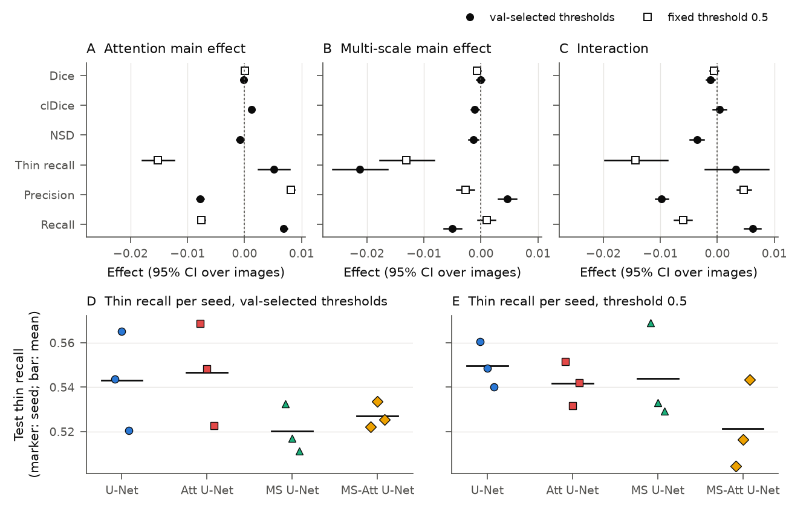

### fig_sam
**Whole-image and tiled SAM (test set).** (A) Centreline recall by vessel width for each training seed (markers; bar: seed mean). Dotted and dash-dot lines: the test ground truth pushed through the 512 and 256 output grids and back to 2048 (mask-resampling references; context, not upper bounds). (B) Dice and NSD per seed. Hollow markers: overlapping-tile inference with the tiled models. U-Net is shown for reference.

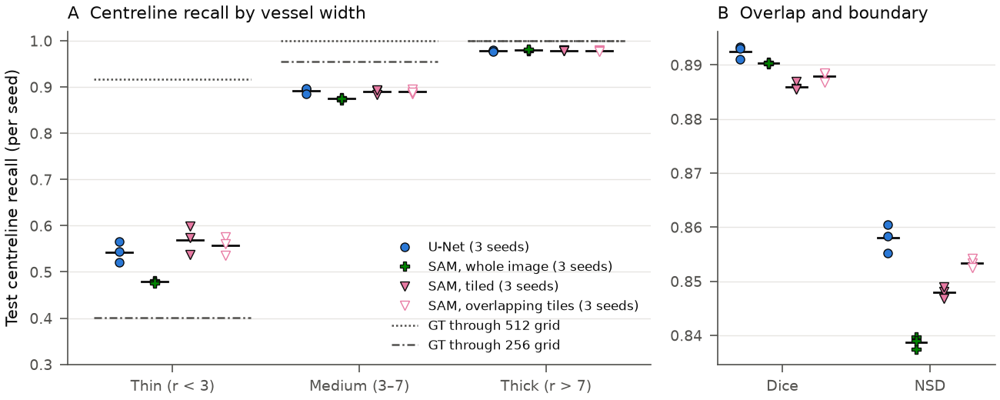

### fig_tradeoff
**Dice does not track thin-vessel recall.** (A, B) Test Dice against test thin-vessel recall, one marker per training seed. (C, D) The checkpoint-selection criterion (best validation Dice at threshold 0.5) against validation thin-vessel recall at the chosen threshold, one marker per training run; overlapping-tile inference has no checkpoint of its own and is omitted from C and D. Axes are shared within each row. Dice spans a much narrower range than thin-vessel recall.

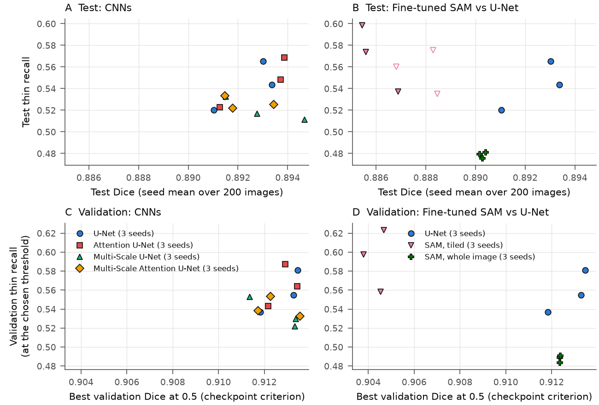

### fig_qualitative_raster
**Qualitative examples (test set, seed-0 models).** One test image per disease category, drawn at random with a fixed seed. Left: original image (not contrast-enhanced) with the analysed window (white box; area outside the FOV pixelated); crop: the 256 × 256 native-resolution window of the original image with the most thin-vessel ground-truth centreline, chosen automatically. Error maps (grey true positive, orange false positive, blue false negative) at each model's validation-selected threshold for the U-Net, the Multi-Scale U-Net (lowest CNN thin-vessel recall) and the two SAM configurations; all seven configurations are shown in S3 Fig.

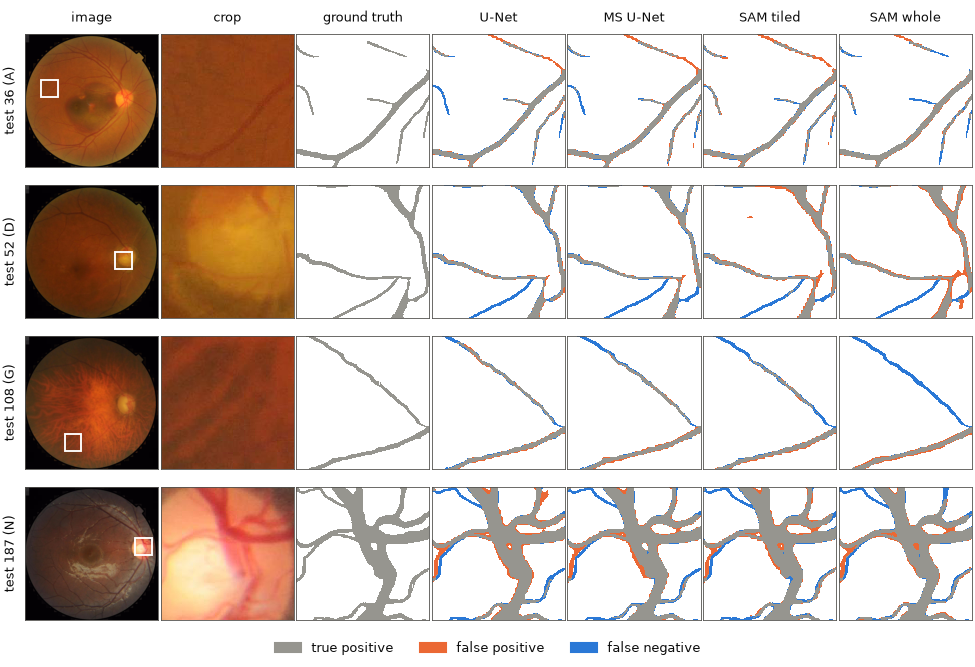

## Main tables

### Table: data
**Data, split and audit.** Top: images per disease category in the official FIVES split and in the split used here (training and validation drawn from the official training images with seed 17, 30 validation images per category; 85 groups of duplicate or possibly same-patient images, 177 images, never split). Bottom: findings of the data audit of all 800 images and masks in the copy used (Hugging Face mirror of FIVES, identical to the official release), made before any model was trained. Markings were detected and compared as binary patterns only and were never read.

| Category | Official train | Official test | Train | Validation | Excluded | Test |
|---|---|---|---|---|---|---|
| AMD (A) | 150 | 50 | 120 | 30 | 0 | 50 |
| DR (D) | 150 | 50 | 119 | 30 | 1 | 50 |
| Glaucoma (G) | 150 | 50 | 118 | 30 | 2 | 50 |
| Normal (N) | 150 | 50 | 120 | 30 | 0 | 50 |
| Total | 600 | 200 | 477 | 120 | 3 | 200 |

| Audit finding | Detail | Handling |
|---|---|---|
| Same image file, two different masks | 5 pairs in train, 1 in test; mask Dice over the whole image 0.878–0.982 (train), 0.993 (test) | Train pairs kept on one side of the split; test pair counted as two images |
| Empty ground-truth mask | 2 very dark images (a near-identical pair) | Excluded |
| Same eye in official train and test | 1 pair, vessel-layout IoU 0.997 | Training image excluded; test set unchanged |
| Annotation lines outside the eye | 19 masks, 41,117 pixels | All scoring inside a fitted FOV mask; masks not edited |
| Burned-in text markings outside the eye | 574 of 800 images; possibly identifying | Never read; pixelated in all figures; compared only as binary patterns |
| Possibly same patient (identical marking pattern, isolated pair) | 70 pairs: 13 train–test, 8 validation–test, 0 train–validation, 18 within test | Grouped within the official training set; pairs involving test remain |

### Table: models
**Models compared.** Everything not listed is shared by all trained models: data split, CLAHE preprocessing, augmentation (flips and 90° rotations), loss (binary cross-entropy + soft Dice), Adam with learning rate 10⁻⁴, effective batch 4, early stopping on validation Dice at 2048 (patience 20, at most 150 epochs), mixed precision, three seeds, threshold chosen on validation, and scoring at 2048 inside the FOV. Parameters in millions (trainable / total).

| Model | Change vs U-Net | Network input | Training target | Output grid | Params (M) |
|---|---|---|---|---|---|
| U-Net | -- | CLAHE image, area-resized to 512 | soft mask at 512 | 512 | 31.0 / 31.0 |
| Attention U-Net | attention gates on 4 skips | as U-Net | as U-Net | 512 | 32.1 / 32.1 |
| Multi-Scale U-Net | multi-scale block in 9 blocks | as U-Net | as U-Net | 512 | 32.8 / 32.8 |
| Multi-Scale Attention U-Net | both | as U-Net | as U-Net | 512 | 33.8 / 33.8 |
| SAM, tiled | SAM ViT-B, LoRA r=4 + decoder | 4 native 1024 crops | binary native crop | 512 (4×256 stitched) | 4.2 / 93.9 |
| SAM, overlapping tiles | same models as tiled | 9 native 1024 crops, stride 512 | -- | 512 (tent-blended) | 4.2 / 93.9 |
| SAM, whole image | SAM ViT-B, LoRA r=4 + decoder | CLAHE image, area-resized to 1024 | soft mask at 1024 | 1024 (from 256) | 4.2 / 93.9 |

### Table: main
**Test results.** Mean ± standard deviation across 3 training seeds of each seed's mean over the 200 test images, each run at its own threshold chosen on validation. Thin, medium and thick: centreline recall by ground-truth vessel radius (< 3, 3–7, > 7 px at 2048, 1-px tolerance). NSD: normalized surface Dice (boundary-pixel approximation, 2 px). Overlapping tiles: inference-only variant of the tiled SAM models.

| Model | Dice | clDice | NSD | Thin | Medium | Thick |
|---|---|---|---|---|---|---|
| *CNNs (2 × 2 ablation)* | | | | | | |
| U-Net | 0.8925 ± 0.0013 | 0.9083 ± 0.0021 | 0.8580 ± 0.0026 | 0.5430 ± 0.0224 | 0.8921 ± 0.0056 | 0.9786 ± 0.0013 |
| Attention U-Net | 0.8929 ± 0.0015 | 0.9094 ± 0.0021 | 0.8590 ± 0.0024 | 0.5465 ± 0.0230 | 0.8943 ± 0.0047 | 0.9793 ± 0.0004 |
| Multi-Scale U-Net | 0.8930 ± 0.0016 | 0.9071 ± 0.0022 | 0.8584 ± 0.0015 | 0.5202 ± 0.0111 | 0.8903 ± 0.0011 | 0.9780 ± 0.0020 |
| Multi-Scale Attention U-Net | 0.8922 ± 0.0011 | 0.9085 ± 0.0002 | 0.8559 ± 0.0041 | 0.5269 ± 0.0058 | 0.8884 ± 0.0021 | 0.9778 ± 0.0011 |
| *Fine-tuned SAM (LoRA)* | | | | | | |
| SAM, tiled | 0.8860 ± 0.0008 | 0.9062 ± 0.0010 | 0.8480 ± 0.0011 | 0.5697 ± 0.0308 | 0.8894 ± 0.0058 | 0.9784 ± 0.0013 |
| SAM, overlapping tiles | 0.8879 ± 0.0009 | 0.9079 ± 0.0011 | 0.8534 ± 0.0008 | 0.5569 ± 0.0203 | 0.8894 ± 0.0053 | 0.9779 ± 0.0022 |
| SAM, whole image | 0.8903 ± 0.0001 | 0.9006 ± 0.0006 | 0.8387 ± 0.0012 | 0.4786 ± 0.0029 | 0.8746 ± 0.0018 | 0.9797 ± 0.0010 |

### Table: paired
**Image-level comparison with U-Net.** Mean over the 200 test images of the per-image difference from U-Net (each image's metric averaged over the model's seeds first), with the Holm-adjusted p-value of a two-sided paired Wilcoxon signed-rank test (correction within each metric across the six comparisons). These tests treat images as the sample and do not include training-seed variability.

| Model − U-Net | Dice | Thin | clDice | NSD |
|---|---|---|---|---|
| Attention U-Net | +0.0005 (0.248) | +0.0035 (0.006) | +0.0010 (1.3×10^-4) | +0.0010 (0.026) |
| Multi-Scale U-Net | +0.0005 (0.002) | −0.0228 (7.2×10^-15) | −0.0012 (1.6×10^-4) | +0.0005 (0.652) |
| Multi-Scale Attention U-Net | −0.0002 (0.258) | −0.0161 (9.7×10^-10) | +0.0002 (0.900) | −0.0021 (7.7×10^-4) |
| SAM, tiled | −0.0065 (1.7×10^-23) | +0.0267 (8.9×10^-8) | −0.0021 (3.9×10^-6) | −0.0100 (2.9×10^-19) |
| SAM, overlapping tiles | −0.0046 (6.8×10^-18) | +0.0139 (0.004) | −0.0004 (0.317) | −0.0046 (1.6×10^-8) |
| SAM, whole image | −0.0022 (2.7×10^-7) | −0.0644 (1.8×10^-19) | −0.0078 (5.9×10^-19) | −0.0193 (4.4×10^-27) |

### Table: ablation
**2 × 2 ablation of attention gates and multi-scale blocks.** Effects on test metrics with 95% bootstrap confidence intervals (resampling the 200 images; each image averaged over seeds). Attention main effect: mean of (Attention U-Net − U-Net) and (Multi-Scale Attention U-Net − Multi-Scale U-Net); multi-scale main effect likewise; interaction: (Multi-Scale Attention U-Net − Multi-Scale U-Net) − (Attention U-Net − U-Net). clDice and NSD exist only at the val-selected thresholds.

| Metric | Attention | Multi-scale | Interaction |
|---|---|---|---|
| *Threshold: val-selected* | | | |
| Dice | −0.0001 [−0.0005, +0.0003] | −0.0001 [−0.0008, +0.0005] | −0.0012 [−0.0019, −0.0005] |
| Thin recall | +0.0051 [+0.0023, +0.0079] | −0.0212 [−0.0260, −0.0163] | +0.0032 [−0.0022, +0.0089] |
| clDice | +0.0012 [+0.0007, +0.0017] | −0.0011 [−0.0018, −0.0003] | +0.0004 [−0.0008, +0.0015] |
| NSD | −0.0008 [−0.0014, −0.0002] | −0.0013 [−0.0022, −0.0004] | −0.0035 [−0.0048, −0.0023] |
| Precision | −0.0078 [−0.0084, −0.0072] | +0.0046 [+0.0030, +0.0062] | −0.0098 [−0.0109, −0.0087] |
| Recall | +0.0069 [+0.0063, +0.0075] | −0.0050 [−0.0065, −0.0034] | +0.0062 [+0.0048, +0.0076] |
| *Threshold: fixed 0.5* | | | |
| Dice | +0.0001 [−0.0003, +0.0004] | −0.0006 [−0.0013, 0.0000] | −0.0006 [−0.0014, +0.0002] |
| Thin recall | −0.0152 [−0.0180, −0.0124] | −0.0131 [−0.0177, −0.0082] | −0.0144 [−0.0198, −0.0087] |
| Precision | +0.0082 [+0.0076, +0.0087] | −0.0027 [−0.0043, −0.0012] | +0.0046 [+0.0034, +0.0058] |
| Recall | −0.0075 [−0.0081, −0.0069] | +0.0010 [−0.0005, +0.0025] | −0.0060 [−0.0075, −0.0045] |

### Table: cost
**Computational cost.** One NVIDIA L40S GPU. Inference: one image per call over the 200 test images after 10 warm-up calls, from the input on the GPU to the probability map (tiling, stitching or blending included); FLOPs per image from PyTorch's FlopCounterMode; peak memory allocated. Training time and memory: seed-0 runs.

| Model | Trainable params (M) | Inference (ms/image) | GFLOPs/image | Inference memory (GB) | Training time (h) | Training memory (GB) |
|---|---|---|---|---|---|---|
| U-Net | 31.0 | 4.4 | 385 | 0.49 | 0.43 | 3.36 |
| Attention U-Net | 32.1 | 5.3 | 392 | 0.50 | 0.41 | 3.41 |
| Multi-Scale U-Net | 32.8 | 7.8 | 405 | 0.50 | 0.45 | 4.33 |
| Multi-Scale Attention U-Net | 33.8 | 8.4 | 411 | 0.51 | 0.41 | 4.38 |
| SAM, tiled | 4.2 | 190.2 | 3,908 | 5.62 | 9.18 | 15.66 |
| SAM, overlapping tiles | 4.2 | 428.7 | 8,793 | 4.39 | (tiled models) | -- |
| SAM, whole image | 4.2 | 48.0 | 977 | 1.68 | 2.86 | 15.66 |

## Supporting figures

### fig_cost
**Inference cost and thin-vessel recall.** Inference time per image on one NVIDIA L40S (seed-0 models, batch of one, log scale) against test thin-vessel recall (marker: seed mean; vertical bar: range across 3 seeds). Circles: CNNs; triangles: SAM (hollow: overlapping tiles).

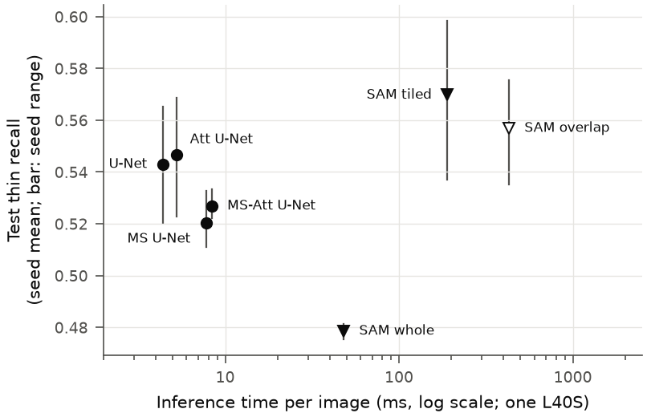

### fig_threshold_val
**Thin-vessel recall against the threshold (validation set).** As in the test-set figure, on the 120 validation images.

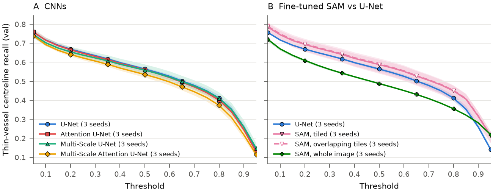

### fig_precision_thin
**Thin-vessel recall against overall precision (test set).** Post hoc. Each curve joins the operating points of one configuration at thresholds 0.05–0.95 (step 0.01; mean over 3 seeds of the means over 200 images); marker: threshold 0.5. Curves further up at the same precision recover more thin-vessel centreline. (A) The four CNNs. (B) The SAM configurations and the U-Net.

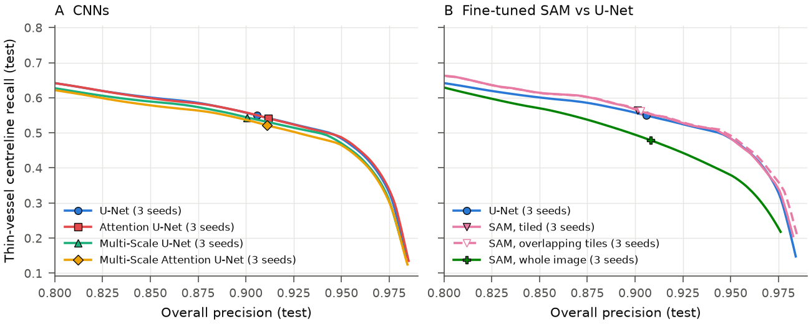

### fig_disease
**Results by disease category (test set).** Dice (top) and thin-vessel recall (bottom) per category; marker: seed mean; bar: standard deviation across 3 seeds (other figures show the range across seeds).

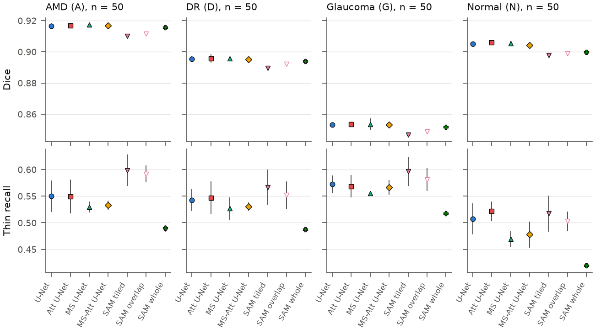

### fig_training
**Validation Dice during training.** Validation Dice (2048, threshold 0.5, inside the FOV) per epoch for every training run (colour: model; line style: seed), from the saved training logs; dashed vertical line: the 150-epoch limit. (A) The four CNNs. (B) Tiled and whole-image SAM; 2 tiled and 3 whole-image runs reached the limit.

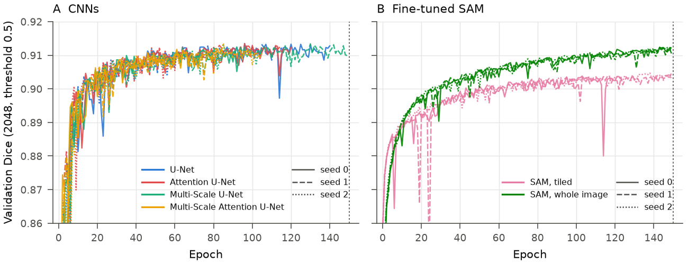

### fig_bland_altman
**Image-derived vessel measures.** Bland–Altman plots of vessel density and fractal dimension, predicted minus ground truth against their mean (per-image values averaged over seeds); solid line: mean difference; dashed: 95% limits of agreement.

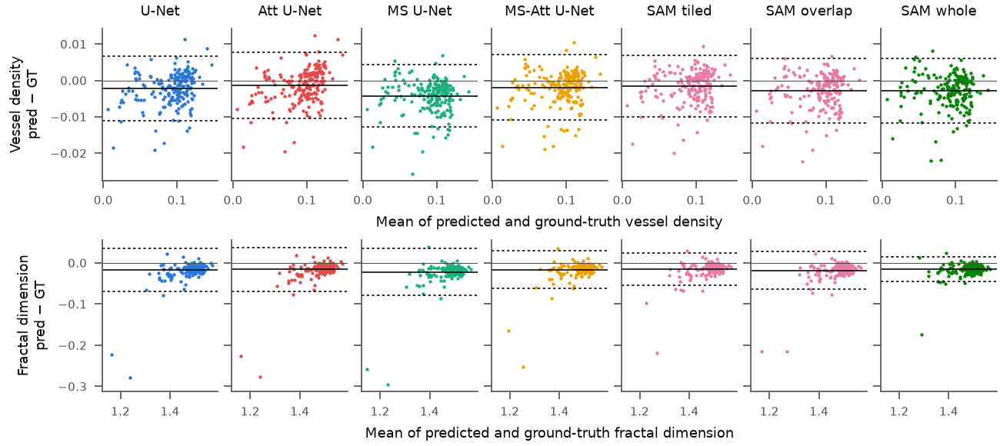

### fig_si_qualitative_raster
**All qualitative test images.** The eight test images (two per category, drawn at random with a fixed seed), native-resolution crops with the most thin-vessel centreline, error maps of every model (seed 0) at its validation-selected threshold. Colours as in the qualitative figure.

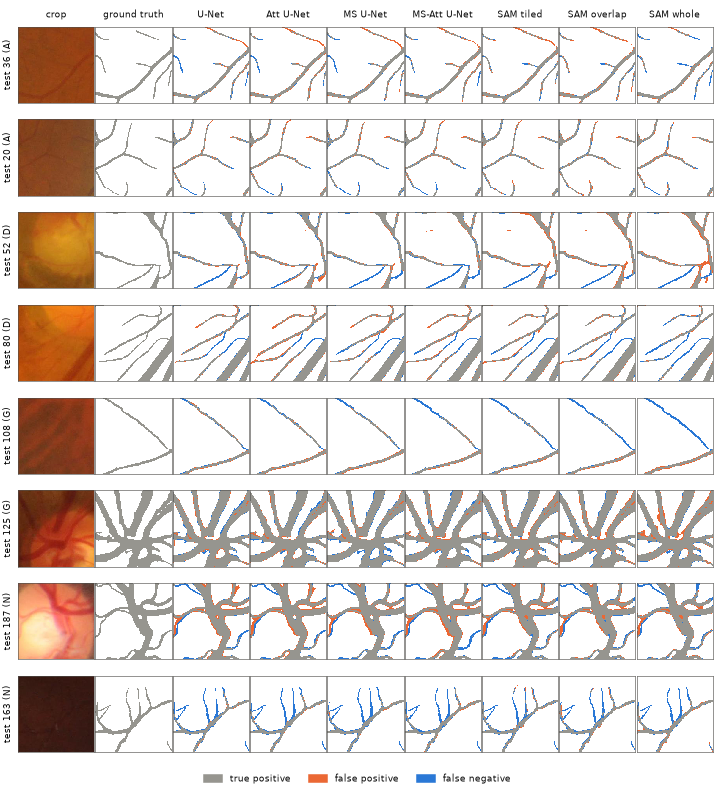

## Supporting tables

### Table: oracle
**Oracle-prompted SAM and mask-resampling references.** Test set, means over 200 images. The oracle rows use five positive and five negative points sampled from each image's own ground truth, so they are not comparable with the automatic models and are not ranked against them. The references push each test ground truth through an output grid and back to 2048 (soft downsampling, bilinear upsampling, same threshold rule); they show what the grid itself loses and are not upper bounds. Oracle prompts: K = 5 chosen on validation (validation Dice 0.181, 0.180 and 0.180 for K = 5, 10 and 20); inference 87.5 ms per image (SAM's default single-precision path, against mixed precision for the fine-tuned models).

| Row | Dice | Precision | Recall | Thin | clDice | NSD |
|---|---|---|---|---|---|---|
| SAM zero-shot, oracle prompts (K = 5) | 0.174 | 0.096 | 0.975 | 0.976 | 0.146 | 0.018 |
| Reference: ground truth through the 512 grid | 0.985 | 0.986 | 0.984 | 0.916 | 0.990 | 0.996 |
| Reference: ground truth through the 256 grid | 0.941 | 0.967 | 0.918 | 0.400 | 0.941 | 0.936 |

### Table: si_agreement
**Agreement between two available annotations of the same image.** Post hoc descriptive analysis added during writing, using labels only (no model predictions). FIVES contains 6 byte-identical image files with two different masks (all AMD images); the dataset does not say who drew them, so this is not inter-rater agreement. Each mask was scored against the other with the evaluation metrics (2048, inside the FOV, 1-px tolerance for centreline recall); values are the mean of the two directions (lowest single direction for thin vessels: 0.30). Dice here is computed inside the FOV; Table 1 gives the same pairs' mask Dice over the whole image. n = 6.

| Images | Split | Dice | Thin | Medium | Thick | clDice | NSD |
|---|---|---|---|---|---|---|---|
| test_32_A / test_48_A | test | 0.993 | 0.922 | 0.998 | 0.999 | 0.989 | 0.984 |
| train_34_A / train_118_A | train | 0.982 | 0.728 | 0.984 | 0.998 | 0.951 | 0.944 |
| train_39_A / train_132_A | train | 0.883 | 0.657 | 0.962 | 0.996 | 0.904 | 0.908 |
| train_53_A / train_97_A | train | 0.960 | 0.522 | 0.976 | 1.000 | 0.885 | 0.891 |
| train_55_A / train_134_A | train | 0.970 | 0.590 | 0.972 | 0.999 | 0.919 | 0.911 |
| train_61_A / train_121_A | train | 0.978 | 0.793 | 0.986 | 0.995 | 0.955 | 0.952 |
| Mean |  | 0.961 | 0.702 | 0.980 | 0.998 | 0.934 | 0.932 |

### Table: si_overlap
**IoU, precision and recall on the test set.** Mean ± standard deviation across 3 seeds (Holm-adjusted Wilcoxon p-value vs U-Net in brackets).

| Model | IoU | Precision | Recall |
|---|---|---|---|
| U-Net | 0.8140 ± 0.0018 | 0.9111 ± 0.0123 | 0.8803 ± 0.0126 |
| Attention U-Net | 0.8146 ± 0.0021 (0.262) | 0.9082 ± 0.0099 (6.1×10^-14) | 0.8841 ± 0.0121 (2.6×10^-19) |
| Multi-Scale U-Net | 0.8150 ± 0.0019 (0.001) | 0.9206 ± 0.0038 (1.8×10^-22) | 0.8722 ± 0.0058 (1.4×10^-19) |
| Multi-Scale Attention U-Net | 0.8135 ± 0.0018 (0.280) | 0.9080 ± 0.0103 (4.1×10^-5) | 0.8822 ± 0.0073 (0.007) |
| SAM, tiled | 0.8029 ± 0.0014 (1.9×10^-24) | 0.8990 ± 0.0091 (6.8×10^-24) | 0.8775 ± 0.0086 (5.7×10^-5) |
| SAM, overlapping tiles | 0.8062 ± 0.0013 (5.8×10^-19) | 0.9086 ± 0.0062 (0.001) | 0.8737 ± 0.0076 (1.5×10^-11) |
| SAM, whole image | 0.8096 ± 0.0001 (2.5×10^-7) | 0.9082 ± 0.0027 (0.676) | 0.8764 ± 0.0026 (5.7×10^-5) |

### Table: si_width
**Width classes with alternative cut-offs.** Centreline recall with radius cut-offs 4 / 8 px instead of 3 / 7 (same predictions; sensitivity check). Mean ± standard deviation across 3 seeds.

| Model | Thin (r < 4) | Medium (4–8) | Thick (r > 8) |
|---|---|---|---|
| U-Net | 0.6806 ± 0.0165 | 0.9286 ± 0.0037 | 0.9842 ± 0.0011 |
| Attention U-Net | 0.6829 ± 0.0153 | 0.9304 ± 0.0029 | 0.9848 ± 0.0003 |
| Multi-Scale U-Net | 0.6667 ± 0.0077 | 0.9281 ± 0.0009 | 0.9834 ± 0.0022 |
| Multi-Scale Attention U-Net | 0.6699 ± 0.0035 | 0.9262 ± 0.0017 | 0.9836 ± 0.0012 |
| SAM, tiled | 0.6918 ± 0.0210 | 0.9265 ± 0.0034 | 0.9838 ± 0.0014 |
| SAM, overlapping tiles | 0.6843 ± 0.0159 | 0.9271 ± 0.0034 | 0.9832 ± 0.0027 |
| SAM, whole image | 0.6287 ± 0.0023 | 0.9209 ± 0.0012 | 0.9851 ± 0.0010 |

### Table: si_fixed
**Test results with every run at a fixed threshold of 0.5.** Secondary analysis decided before test evaluation. Mean ± standard deviation across 3 seeds (Holm-adjusted Wilcoxon p-value vs U-Net). clDice and NSD were computed only at the val-selected thresholds.

| Model | Dice | Precision | Recall | Thin |
|---|---|---|---|---|
| U-Net | 0.8918 ± 0.0015 | 0.9057 ± 0.0033 | 0.8838 ± 0.0019 | 0.5496 ± 0.0103 |
| Attention U-Net | 0.8922 ± 0.0012 (0.074) | 0.9116 ± 0.0056 (1.4×10^-28) | 0.8793 ± 0.0028 (6.8×10^-24) | 0.5417 ± 0.0100 (2.9×10^-4) |
| Multi-Scale U-Net | 0.8914 ± 0.0023 (0.003) | 0.9007 ± 0.0066 (1.3×10^-12) | 0.8878 ± 0.0028 (5.0×10^-9) | 0.5438 ± 0.0219 (0.008) |
| Multi-Scale Attention U-Net | 0.8912 ± 0.0012 (0.100) | 0.9112 ± 0.0048 (2.6×10^-12) | 0.8772 ± 0.0069 (1.0×10^-16) | 0.5214 ± 0.0200 (4.2×10^-19) |
| SAM, tiled | 0.8842 ± 0.0003 (3.3×10^-25) | 0.9012 ± 0.0093 (2.7×10^-5) | 0.8719 ± 0.0078 (3.3×10^-22) | 0.5645 ± 0.0397 (0.008) |
| SAM, overlapping tiles | 0.8863 ± 0.0005 (1.8×10^-20) | 0.9028 ± 0.0094 (1.7×10^-4) | 0.8760 ± 0.0080 (3.0×10^-14) | 0.5632 ± 0.0404 (0.008) |
| SAM, whole image | 0.8903 ± 0.0001 (0.002) | 0.9082 ± 0.0027 (7.0×10^-5) | 0.8764 ± 0.0026 (2.5×10^-11) | 0.4786 ± 0.0029 (2.5×10^-21) |

### Table: si_disease
**Test results by disease category.** Seed means; each category has 50 test images. Descriptive only: no tests between categories were planned. All metrics: test\_disease.csv in the repository.

| Model | Dice A | Dice D | Dice G | Dice N | Thin A | Thin D | Thin G | Thin N |
|---|---|---|---|---|---|---|---|---|
| U-Net | 0.9165 | 0.8954 | 0.8531 | 0.9050 | 0.5498 | 0.5426 | 0.5722 | 0.5075 |
| Attention U-Net | 0.9167 | 0.8956 | 0.8535 | 0.9059 | 0.5492 | 0.5469 | 0.5685 | 0.5215 |
| Multi-Scale U-Net | 0.9175 | 0.8957 | 0.8534 | 0.9053 | 0.5293 | 0.5268 | 0.5555 | 0.4691 |
| Multi-Scale Attention U-Net | 0.9167 | 0.8950 | 0.8531 | 0.9041 | 0.5329 | 0.5306 | 0.5665 | 0.4776 |
| SAM, tiled | 0.9100 | 0.8895 | 0.8467 | 0.8977 | 0.5987 | 0.5667 | 0.5963 | 0.5172 |
| SAM, overlapping tiles | 0.9115 | 0.8922 | 0.8488 | 0.8989 | 0.5918 | 0.5520 | 0.5814 | 0.5026 |
| SAM, whole image | 0.9156 | 0.8940 | 0.8517 | 0.8999 | 0.4897 | 0.4875 | 0.5175 | 0.4197 |

### Table: si_vessel
**Image-derived vessel measures.** Vessel density (vessel pixels per FOV pixel; ground-truth mean 0.093) and box-counting fractal dimension (ground-truth mean 1.490), predicted vs ground truth on the 200 test images (per-image values averaged over seeds). Bias: mean of predicted − ground truth; MAD: mean absolute difference; r: Pearson correlation. Not clinically validated.

| Model | Density bias | Density MAD | Density r | FD bias | FD MAD | FD r |
|---|---|---|---|---|---|---|
| U-Net | −0.0021 | 0.0037 | 0.987 | −0.0177 | 0.0182 | 0.930 |
| Attention U-Net | −0.0013 | 0.0036 | 0.988 | −0.0161 | 0.0168 | 0.932 |
| Multi-Scale U-Net | −0.0042 | 0.0046 | 0.986 | −0.0221 | 0.0226 | 0.913 |
| Multi-Scale Attention U-Net | −0.0019 | 0.0034 | 0.986 | −0.0164 | 0.0170 | 0.935 |
| SAM, tiled | −0.0016 | 0.0033 | 0.988 | −0.0155 | 0.0162 | 0.948 |
| SAM, overlapping tiles | −0.0028 | 0.0038 | 0.986 | −0.0182 | 0.0188 | 0.938 |
| SAM, whole image | −0.0029 | 0.0039 | 0.986 | −0.0155 | 0.0160 | 0.961 |

### Table: si_runs
**Training runs.** Epochs run (maximum 150), best epoch, threshold chosen on validation, best validation Dice at threshold 0.5 (the checkpoint-selection criterion) and validation thin-vessel recall at the chosen threshold. Overlapping tiles reuse the tiled models; only their thresholds were chosen separately on validation.

| Model | Seed | Epochs | Best epoch | Threshold | Val Dice (0.5) | Val thin |
|---|---|---|---|---|---|---|
| U-Net | 0 | 141 | 120 | 0.55 | 0.9133 | 0.555 |
| U-Net | 1 | 117 | 96 | 0.45 | 0.9135 | 0.581 |
| U-Net | 2 | 69 | 48 | 0.55 | 0.9118 | 0.537 |
| Attention U-Net | 0 | 121 | 100 | 0.45 | 0.9129 | 0.587 |
| Attention U-Net | 1 | 117 | 96 | 0.45 | 0.9134 | 0.564 |
| Attention U-Net | 2 | 69 | 48 | 0.55 | 0.9122 | 0.543 |
| Multi-Scale U-Net | 0 | 96 | 75 | 0.60 | 0.9114 | 0.553 |
| Multi-Scale U-Net | 1 | 150 | 130 | 0.55 | 0.9134 | 0.529 |
| Multi-Scale U-Net | 2 | 106 | 85 | 0.55 | 0.9133 | 0.522 |
| Multi-Scale Attention U-Net | 0 | 82 | 61 | 0.45 | 0.9117 | 0.538 |
| Multi-Scale Attention U-Net | 1 | 105 | 84 | 0.45 | 0.9123 | 0.553 |
| Multi-Scale Attention U-Net | 2 | 106 | 85 | 0.55 | 0.9135 | 0.532 |
| SAM, tiled | 0 | 124 | 103 | 0.55 | 0.9038 | 0.597 |
| SAM, tiled | 1 | 150 | 149 | 0.45 | 0.9045 | 0.558 |
| SAM, tiled | 2 | 150 | 138 | 0.45 | 0.9047 | 0.623 |
| SAM, whole image | 0 | 150 | 143 | 0.50 | 0.9124 | 0.489 |
| SAM, whole image | 1 | 150 | 149 | 0.50 | 0.9124 | 0.491 |
| SAM, whole image | 2 | 150 | 145 | 0.50 | 0.9124 | 0.483 |
| SAM, overlapping tiles | 0 | (tiled) | (tiled) | 0.55 | -- | -- |
| SAM, overlapping tiles | 1 | (tiled) | (tiled) | 0.45 | -- | -- |
| SAM, overlapping tiles | 2 | (tiled) | (tiled) | 0.55 | -- | -- |

### Table: si_resize
**Training-mask resizing.** Thirty training masks (stratified by category, seed 0) downsampled by each method, upsampled back to 2048 as predictions are (bilinear, threshold 0.5) and scored against the original masks inside the FOV. Chosen before any model was trained. At 1024, max-pooling and area average ≥ 0.25 coincide for 2 × 2 blocks.

| Size | Method | Dice | Precision | Thin recall |
|---|---|---|---|---|
| 512 | nearest neighbour | 0.935 | 0.935 | 0.932 |
| 512 | area average ≥ 0.5 | 0.940 | 0.928 | 0.956 |
| 512 | area average ≥ 0.25 | 0.920 | 0.856 | 0.994 |
| 512 | max-pooling | 0.877 | 0.781 | 1.000 |
| 512 | area average, no threshold (used) | 0.984 | 0.986 | 0.926 |
| 512 | soft, scored at threshold 0.25 (illustration) | 0.904 | -- | 0.996 |
| 1024 | nearest neighbour | 0.960 | 0.960 | 0.981 |
| 1024 | area average ≥ 0.5 | 0.967 | 0.948 | 1.000 |
| 1024 | area average ≥ 0.25 | 0.955 | 0.914 | 1.000 |
| 1024 | max-pooling | 0.955 | 0.914 | 1.000 |
| 1024 | area average, no threshold (used) | 0.995 | 0.995 | 0.988 |
| 1024 | soft, scored at threshold 0.25 (illustration) | 0.945 | -- | 1.000 |

### Table: si_pilot
**Resolution pilot (validation).** U-Net seed 0 at 512 and at 1024, each at its own threshold chosen on validation (means over 120 images). The rule fixed before the pilot required a thin-recall gain of at least 0.05 with a Dice loss of at most 0.005 to move the CNNs to 1024; the thin-recall gain was below 0.05, so all CNNs stayed at 512.

| Run | Dice | Thin recall | Epoch (s) | Peak memory (GB) |
|---|---|---|---|---|
| U-Net, 512 (used) | 0.9142 | 0.5548 | 11.0 | 3.36 |
| U-Net, 1024 (pilot) | 0.9240 | 0.5943 | 44.2 | 12.25 |
| Difference | +0.0098 | +0.0395 |  |  |

### Table: si_seam
**Tile-seam check (validation, seed 0).** Jump ratio: mean probability jump across the tile seam divided by the median jump between other adjacent rows and columns (about 1: no seam). Difference-in-differences against U-Net in a ±16 px band around the seam, relative to bands around the tile midlines, with 95% bootstrap CIs over 120 images.

| Run | Jump ratio | Dice DiD | Thin recall DiD |
|---|---|---|---|
| Tiled SAM (non-overlapping) | 1.43 | −0.029 [−0.034, −0.024] | −0.064 [−0.104, −0.023] |
| Overlapping tiles | 1.00 | −0.001 [−0.004, +0.003] | +0.021 [−0.011, +0.054] |
| Whole-image SAM (no seams) | 1.06 | -- | -- |
| U-Net (no seams) | 0.99 | -- | -- |

### Table: si_simple
**Simple effects in the 2 × 2 ablation.** Differences of model means on the 200 test images (each a mean over 3 seeds): attention without multi-scale blocks (Attention U-Net − U-Net), attention with them (Multi-Scale Attention U-Net − Multi-Scale U-Net), and the multi-scale block without and with attention. Point estimates only; the main effects and interaction with confidence intervals are in Table 5.

| Metric, threshold rule | Attention, no MS | Attention, with MS | MS, no attention | MS, with attention |
|---|---|---|---|---|
| Thin recall, validation-selected | +0.0035 | +0.0067 | −0.0228 | −0.0196 |
| Precision, validation-selected | −0.0029 | −0.0127 | +0.0095 | −0.0003 |
| Recall, validation-selected | +0.0038 | +0.0100 | −0.0081 | −0.0019 |
| Dice, validation-selected | +0.0005 | −0.0008 | +0.0005 | −0.0007 |
| Thin recall, fixed 0.5 | −0.0080 | −0.0224 | −0.0059 | −0.0203 |
| Precision, fixed 0.5 | +0.0058 | +0.0105 | −0.0051 | −0.0004 |
| Recall, fixed 0.5 | −0.0045 | −0.0106 | +0.0040 | −0.0020 |
| Dice, fixed 0.5 | +0.0004 | −0.0002 | −0.0003 | −0.0009 |

### Table: si_imagelevel
**Image-level spread of the test results.** Standard deviation over the 200 test images / median, of the per-image values averaged over 3 seeds.

| Model | Dice | Thin | clDice | NSD |
|---|---|---|---|---|
| U-Net | 0.088 / 0.9167 | 0.135 / 0.5551 | 0.090 / 0.9349 | 0.129 / 0.8979 |
| Attention U-Net | 0.086 / 0.9158 | 0.138 / 0.5586 | 0.090 / 0.9338 | 0.128 / 0.8989 |
| Multi-Scale U-Net | 0.089 / 0.9168 | 0.133 / 0.5231 | 0.091 / 0.9325 | 0.128 / 0.8988 |
| Multi-Scale Attention U-Net | 0.087 / 0.9159 | 0.132 / 0.5295 | 0.089 / 0.9337 | 0.130 / 0.8978 |
| SAM, tiled | 0.084 / 0.9084 | 0.141 / 0.5746 | 0.087 / 0.9296 | 0.128 / 0.8879 |
| SAM, overlapping tiles | 0.087 / 0.9108 | 0.145 / 0.5790 | 0.090 / 0.9322 | 0.129 / 0.8927 |
| SAM, whole image | 0.081 / 0.9141 | 0.129 / 0.4665 | 0.081 / 0.9254 | 0.129 / 0.8814 |

### Table: si_matched
**Thin-vessel recall at matched precision (test).** Post hoc. For every run, the threshold (grid 0.01–0.99) whose mean validation precision was closest to a target was chosen on the validation set and applied to the test set. Columns 2–5: target = the U-Net's mean validation precision at its selected thresholds (0.926); thresholds over the 3 seeds; test precision, Dice and thin-vessel recall, mean (SD over seeds). Columns 6–7: thin-vessel recall with targets 0.90 and 0.95.

| Model | Thresholds | Precision | Dice | Thin recall | Thin, P = 0.90 | Thin, P = 0.95 |
|---|---|---|---|---|---|---|
| U-Net | [0.51, 0.53] | 0.911 | 0.892 | 0.543 (0.013) | 0.575 | 0.510 |
| Attention U-Net | [0.47, 0.52] | 0.911 | 0.892 | 0.543 (0.009) | 0.574 | 0.508 |
| Multi-Scale U-Net | [0.52, 0.56] | 0.911 | 0.892 | 0.531 (0.015) | 0.563 | 0.504 |
| Multi-Scale Attention U-Net | [0.49, 0.51] | 0.910 | 0.891 | 0.523 (0.016) | 0.555 | 0.489 |
| SAM, tiled | [0.52, 0.58] | 0.914 | 0.885 | 0.546 (0.030) | 0.586 | 0.511 |
| SAM, overlapping tiles | [0.52, 0.57] | 0.915 | 0.887 | 0.546 (0.031) | 0.585 | 0.512 |
| SAM, whole image | [0.50, 0.52] | 0.910 | 0.890 | 0.475 (0.004) | 0.523 | 0.417 |

### Table: si_precision
**Width-stratified precision, spur-pruned thin class, and clDice and NSD at 0.5 (test).** Post hoc, added after the main test evaluation; saved probability maps re-scored, nothing predicted again. Means over 3 seeds of the means over 200 test images. Width-stratified precision: share of the predicted centreline, classed by the prediction's own radius (thin < 3, medium 3–7, thick > 7 px), that lies within 1 px of a ground-truth vessel; columns 2–7 at each run's validation-selected threshold. Pruned: terminal skeleton branches no longer than 1.5 × the vessel radius + 2 px removed before classing (6.7% of the ground-truth thin centreline). The last two columns are at the fixed threshold 0.5 (Table 3 gives them at the selected thresholds).

| Model | Thin prec. | Medium prec. | Thick prec. | Thin recall | Thin recall, pruned | Thin prec., pruned | clDice at 0.5 | NSD at 0.5 |
|---|---|---|---|---|---|---|---|---|
| U-Net | 0.733 | 0.958 | 0.993 | 0.543 | 0.541 | 0.734 | 0.909 | 0.858 |
| Attention U-Net | 0.716 | 0.957 | 0.993 | 0.547 | 0.544 | 0.717 | 0.909 | 0.860 |
| Multi-Scale U-Net | 0.768 | 0.960 | 0.993 | 0.520 | 0.519 | 0.769 | 0.909 | 0.857 |
| Multi-Scale Attention U-Net | 0.752 | 0.958 | 0.993 | 0.527 | 0.523 | 0.753 | 0.908 | 0.856 |
| SAM, tiled | 0.711 | 0.954 | 0.991 | 0.570 | 0.566 | 0.712 | 0.906 | 0.848 |
| SAM, overlapping tiles | 0.753 | 0.963 | 0.993 | 0.557 | 0.554 | 0.755 | 0.908 | 0.853 |
| SAM, whole image | 0.718 | 0.954 | 0.991 | 0.479 | 0.472 | 0.719 | 0.901 | 0.839 |

### Table: si_stats
**Uncertainty of the main comparisons under three resampling schemes (test).** Post hoc. Estimate: difference of model means (each over 3 seeds and 200 images); for the ablation, main effects and interaction as in Table 5. 95% percentile intervals from 10,000 replicates resampling images (as in the main analysis), clusters of possibly same-patient test images (170 clusters, 30 with more than one image), or clusters together with the seeds of each model (jointly for the coupled CNN seeds, independently for SAM and the U-Net). Last column: number of the 3 seed-paired differences with the sign of the majority. Threshold rules: validation-selected, fixed 0.5, or matched validation precision (S14 Table).

| Comparison | Estimate | Images | Clusters | Seeds × clusters | Same sign |
|---|---|---|---|---|---|
| Thin recall, tiled SAM − U-Net, selected | +0.0267 | [+0.0185, +0.0351] | [+0.0185, +0.0353] | [−0.0097, +0.0624] | 2 |
| Thin recall, tiled SAM − U-Net, 0.5 | +0.0149 | [+0.0067, +0.0232] | [+0.0067, +0.0235] | [−0.0274, +0.0479] | 2 |
| Thin recall, tiled SAM − U-Net, matched | +0.0036 | [−0.0047, +0.0120] | [−0.0046, +0.0124] | [−0.0289, +0.0318] | 2 |
| Thin recall, whole SAM − U-Net, selected | −0.0644 | [−0.0756, −0.0534] | [−0.0756, −0.0525] | [−0.0878, −0.0397] | 3 |
| Thin recall, whole SAM − U-Net, matched | −0.0675 | [−0.0787, −0.0564] | [−0.0787, −0.0555] | [−0.0835, −0.0493] | 3 |
| Dice, tiled SAM − U-Net, selected | −0.0065 | [−0.0075, −0.0054] | [−0.0076, −0.0053] | [−0.0083, −0.0045] | 3 |
| Dice, whole SAM − U-Net, selected | −0.0022 | [−0.0039, −0.0002] | [−0.0042, +0.0004] | [−0.0044, +0.0008] | 3 |
| NSD, tiled SAM − U-Net, selected | −0.0100 | [−0.0120, −0.0080] | [−0.0123, −0.0078] | [−0.0134, −0.0064] | 3 |
| Thin recall, multi-scale effect, selected | −0.0212 | [−0.0260, −0.0163] | [−0.0261, −0.0160] | [−0.0347, −0.0043] | 3 |
| Thin recall, multi-scale effect, 0.5 | −0.0131 | [−0.0177, −0.0082] | [−0.0179, −0.0080] | [−0.0219, −0.0039] | 3 |
| Thin recall, multi-scale effect, matched | −0.0156 | [−0.0203, −0.0107] | [−0.0205, −0.0104] | [−0.0271, −0.0024] | 3 |
| Thin recall, attention effect, selected | +0.0051 | [+0.0023, +0.0079] | [+0.0022, +0.0080] | [−0.0011, +0.0103] | 2 |
| Thin recall, attention effect, 0.5 | −0.0152 | [−0.0180, −0.0124] | [−0.0181, −0.0123] | [−0.0356, +0.0067] | 2 |
| Thin recall, attention effect, matched | −0.0043 | [−0.0071, −0.0016] | [−0.0073, −0.0015] | [−0.0202, +0.0125] | 2 |
| Thin recall, interaction, 0.5 | −0.0144 | [−0.0198, −0.0087] | [−0.0203, −0.0079] | [−0.0531, +0.0121] | 2 |
| Dice, multi-scale effect, selected | −0.0001 | [−0.0008, +0.0005] | [−0.0008, +0.0006] | [−0.0023, +0.0027] | 2 |
| Dice, attention effect, selected | −0.0001 | [−0.0005, +0.0003] | [−0.0006, +0.0004] | [−0.0008, +0.0010] | 2 |
| Dice, interaction, selected | −0.0012 | [−0.0019, −0.0005] | [−0.0020, −0.0005] | [−0.0025, +0.0003] | 3 |
