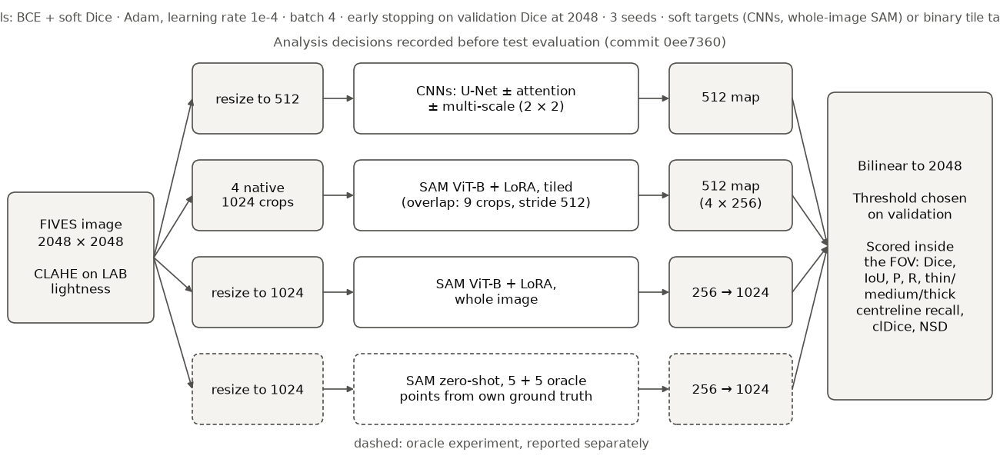
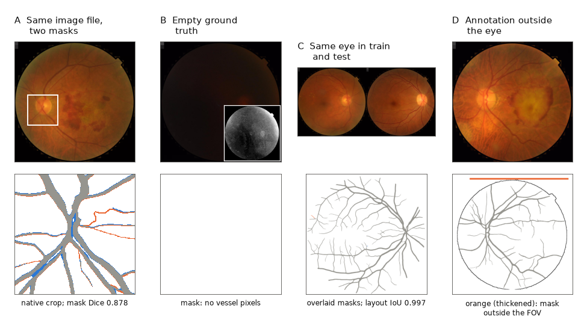
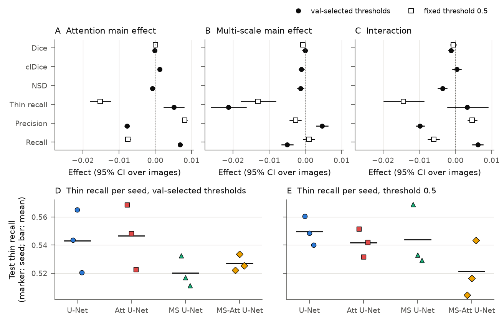
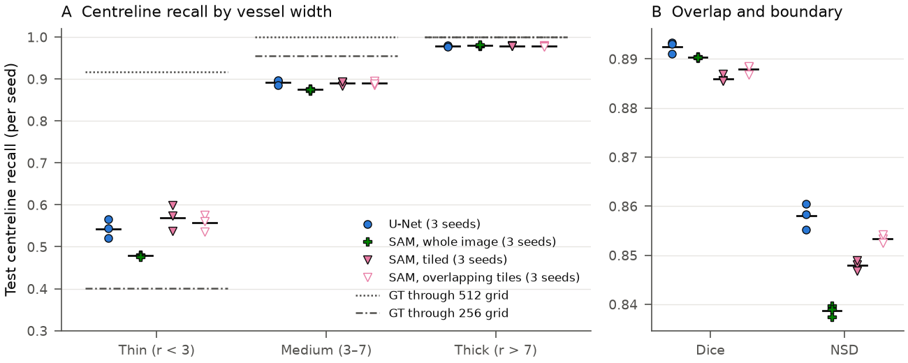
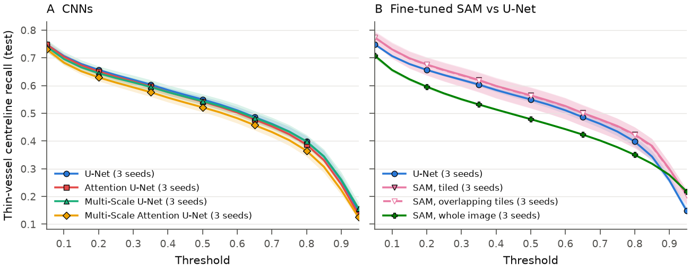
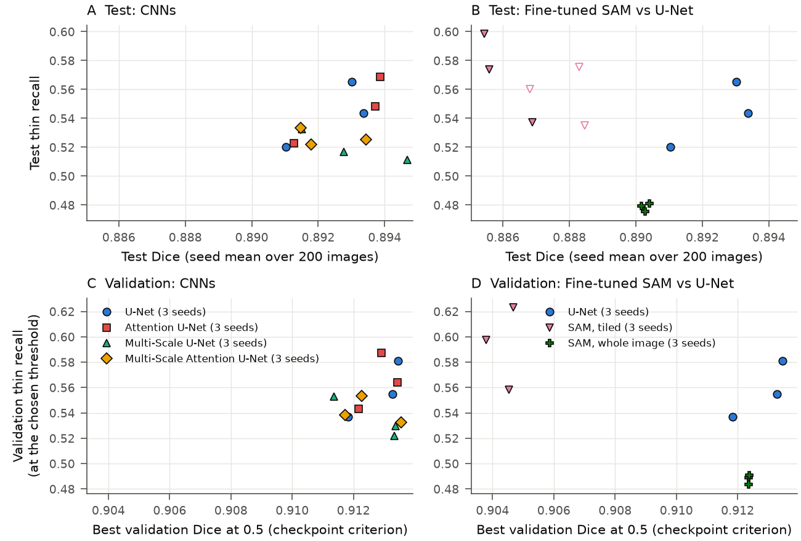
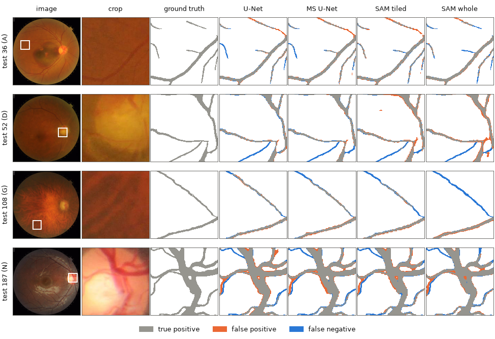

# Attention gates, multi-scale blocks and fine-tuned SAM for thin retinal vessels: a multi-seed evaluation on FIVES

*Reading copy generated from the LaTeX sources by `paper/scripts/preview_md.py`; the LaTeX files are the source of truth. Authors: [TODO].*

## Abstract

Thin retinal vessels hold few pixels, so overlap scores such as Dice change little when they are missed. Using one protocol on
FIVES (800 images, 2048 × 2048), we asked whether
attention gates or multi-scale blocks improve thin-vessel segmentation by a U-Net (question 1), whether a fine-tuned Segment
Anything Model (SAM) helps and how whole-image and tiled configurations differ (question 2), and whether overlap metrics
reveal these differences (question 3). Four convolutional networks formed a 2 × 2 ablation at 512 × 512 with
soft targets; SAM was fine-tuned with low-rank adaptation on whole images and on
full-resolution tiles. Each model was trained with 3 seeds and scored at full
resolution with width-stratified centreline recall, clDice and normalized surface Dice. The analysis was recorded before
testing; two further SAM seeds and post hoc analyses were added afterwards. An audit of FIVES
found duplicate images with different masks, empty masks and one eye in both training and test sets. (1) On
200 test images the networks were tied on Dice (0.8922–0.8930); attention had no consistent effect
on thin-vessel recall, and multi-scale blocks slightly lowered it (−0.0212 and −0.0131 under two threshold
rules, overlapping training-seed variability) while raising its precision (+0.0354). (2) Tiled SAM's small average
gain in thin-vessel recall (+0.0267, within seed variability) largely disappeared at matched precision
(+0.0036, post hoc); it had lower Dice and boundary accuracy in every seed and 43 times the
inference time, and whole-image SAM had lower thin-vessel recall in every seed (−0.0644). (3) Dice differences
were small and did not track thin-vessel differences: the two metrics ranked the SAM configurations in opposite order, and
checkpoint selection by validation Dice did not control thin-vessel recall across seeds. For this dataset, resolution,
targets and loss, no configuration clearly improved thin-vessel segmentation over a plain U-Net, and Dice did not show
this.

## Introduction

Colour fundus photographs show the retinal vessels directly, and changes in these vessels accompany common eye and systemic
diseases: diabetic retinopathy is a microvascular disease whose severe stage involves the growth of new retinal
vessels [wong2016dr], and hypertension is associated with changes in the retinal vessels [wong2004hypertensive].
Automated segmentation of the vessel tree is a building block for measuring such changes [abramoff2010retinal], and
many methods have been proposed for it [fraz2012survey].

The vessels at the ends of the tree are a few pixels wide and have low contrast. In the training masks used here,
centreline points with a local vessel radius below 3 pixels at 2048 × 2048 make up 10.3% of the vessel
centreline. Such vessels contain few pixels, so pixel-overlap scores such as the Dice coefficient [dice1945], which
weight every pixel equally, change little when many of them are missed. Validation guidelines therefore recommend metrics
that match the property of interest [maierhein2024metrics,reinke2024pitfalls], such as clDice for tubular
structures [shit2021cldice].

Two kinds of method are often proposed for fine vessels. One adds modules such as attention
gates [oktay2018attention] and multi-scale blocks [yu2016dilated,liu2022msunet,cao2023mfaunet] to the
U-Net [ronneberger2015unet], a convolutional neural network (CNN); the other fine-tunes the Segment Anything Model
(SAM) [kirillov2023sam], which fails on vessels when used zero-shot [shi2023samzeroshot,qiu2023learnable]. Whether either helps thin vessels is hard to judge from published
results, which come from different protocols and are often summarized with overall accuracy or
Dice [liu2022msunet,cao2023mfaunet]; variation between training runs alone can change the outcome of a
comparison [bouthillier2021variance]. On FIVES [jin2022fives], earlier work compared
architectures [fadugba2024benchmark] and input resolutions [amarnath2026resolution]; the present study
combines thin-vessel metrics with a factorial design, several training seeds, an analysis of threshold choice and a
SAM configuration matched to the CNNs' output grid.

Resolution conditions the questions. At the 512 × 512 input of our CNNs, a thin vessel is at most about one pixel
wide, whereas SAM's decoder predicts a 256 × 256 grid, so each of its output pixels covers 8 × 8 pixels of the
original image. Within this setting we asked three questions. (1) Do attention gates and multi-scale blocks improve
thin-vessel segmentation when everything else is held fixed? (2) Does a fine-tuned SAM offer an advantage, and how do a
whole-image configuration and a tiled configuration with the CNNs' output grid differ? (3) Do overlap metrics reveal the
differences between these methods?

The study makes five contributions:

- An audit of FIVES, confirmed on the official release, which found duplicate images with different masks, empty masks, one eye in both
the training and test sets, annotations outside the eye and burned-in text, and a grouped split that accounts for them.
- A 2 × 2 ablation of attention gates and multi-scale blocks on a fixed U-Net backbone, with three training seeds
per model and identical data, training and stopping rules.
- Prompt-free fine-tuning of SAM on whole images and on full-resolution tiles whose combined output matches the CNNs'
grid, with a check of the tile seams.
- Evaluation at full resolution with centreline recall by vessel width, clDice and normalized surface Dice, and
mask-resampling references for each output grid.
- Separate reporting of training-seed and image-level variability, an analysis of threshold sensitivity, and analysis
decisions recorded in a public commit before the test set was used.

## Related work

### CNN variants for retinal vessels

Most current retinal vessel segmentation methods build on the U-Net [ronneberger2015unet]; earlier approaches are
surveyed in [fraz2012survey]. Retinal models built on attention gates [oktay2018attention] and dilated
multi-scale convolutions [yu2016dilated] combine several changes at once: Liu et al. add
multiscale input and feature modules with position and channel attention and report accuracy on DRIVE and
CHASE_DB1 [liu2022msunet], and Cao et al. combine multi-scale feature fusion with self-attention for microvessels and
report Dice on six datasets including FIVES [cao2023mfaunet]. Because the changes are combined, the contribution of
attention or of multi-scale processing alone is not identified; the 2 × 2 design used here separates them.

### SAM for medical and vessel segmentation

Zero-shot SAM performs very differently across medical datasets, tasks and prompts [mazurowski2023sam,huang2024sam]. Blood vessels are among its failures [shi2023samzeroshot]; in colour
fundus images it could not segment vessels and reached a Dice of 0.1572 on FIVES [qiu2023learnable]. Zhang et al.\
traced such failures to dense, tree-like objects with low textural contrast [zhang2024samlimits]. Fine-tuning on
medical data, either of the whole model [ma2024medsam] or of low-rank adaptation (LoRA) [hu2022lora] layers in the image encoder together with the prompt
encoder and mask decoder [zhang2023samed], improves the results.

### Metrics for thin tubular structures

clDice compares the skeleton of each mask with the other mask and is sensitive to breaks in
connectivity [shit2021cldice]; normalized surface Dice measures how much of each boundary lies within a tolerance of
the other [nikolov2021nsd]. A recent study on input resolution stratified vessel sensitivity by local half-width
(below 3, 3–7 and above 7 pixels) and found that thin-vessel sensitivity of a U-Net on FIVES and HRF peaked when images
were downsampled to widths of 256–876 pixels [amarnath2026resolution]; we use its cut-offs, and our 512-pixel CNN
input lies in that range. On FIVES, a benchmark of five published architectures found that a basic U-Net performed as well
as the more advanced models, while image quality strongly affected the results [fadugba2024benchmark].

## Materials and methods

### Study design

All models were trained and evaluated with one protocol (Fig (pipeline)). Four CNNs formed a 2 × 2 design in which attention gates and multi-scale blocks were switched on or off on a fixed
U-Net backbone. SAM was fine-tuned in two configurations: on whole images reduced to 1024 × 1024 and on four
full-resolution tiles, with an inference-only variant that used overlapping tiles. Each trained model had three seeds,
and all predictions were scored at 2048 × 2048 inside a field-of-view (FOV) mask at a threshold chosen
on the validation set. Zero-shot SAM with point prompts from the ground truth was a separate experiment.

***Study design.** Each 2048 × 2048 FIVES image is contrast-enhanced (CLAHE) and passed to one of four model families. All probability maps are enlarged to 2048 by bilinear interpolation, thresholded at a value chosen on the validation set, and scored against the original masks inside a field-of-view (FOV) mask. Oracle-prompted SAM uses prompts from each image's own ground truth and is reported separately. LoRA: low-rank adaptation; BCE: binary cross-entropy; P, R: precision, recall; NSD: normalized surface Dice.*

### Data, audit and split

This is a retrospective analysis of a public dataset. FIVES [jin2022fives] contains colour fundus photographs of
2048 × 2048 pixels taken with a Topcon TRC-NW8 camera (50^\circ field of view) between 2016 and 2021 at one
hospital, the Second Affiliated Hospital of Zhejiang University, from 573 patients (mean age 48 years, standard
deviation 19.87; 469 images from female and 331 from male subjects; all Asian), with 200 images each of age-related
macular degeneration (AMD), diabetic retinopathy (DR), glaucoma and normal eyes. Every image has a pixelwise vessel
annotation made by trained medical staff and verified by ophthalmologists, which we used as the reference standard without
editing [jin2022fives]. We used the copy on the Hugging Face hub (*tyluan/FIVES*; CC BY 4.0 [jin2022fivesdata]);
all images were RGB and all masks binary. The
official split has 600 training and 200 test images (50 per category); the
sample size was fixed by the dataset. No other dataset was used.

Before any model was trained, we checked all images and masks of this copy for exact and near duplicates, empty masks,
annotations outside the eye and identifying marks (Table (data), Fig (audit); procedures and parameters in
[SI: appendix]). A later check showed that the copy is identical to the official release on figshare, so the
findings apply to FIVES itself. Many images carry burned-in text outside the eye that may contain fragments of patient
names; it was compared only as binary patterns and never read (Ethics statement). Three training images were excluded: two very dark images with empty masks, and one
showing the same eye as a test image.

FIVES provides no patient identifiers. To keep duplicate and possibly same-patient images together, we grouped
byte-identical files (5 pairs), images with an identical marking pattern and consecutive numbers
(79 pairs), and isolated pairs of images with an identical marking pattern (31
pairs): 85 groups containing 177 images. The remaining 597 official training images were
split into 477 training and 120 validation images, 30 per category, with groups assigned whole
(seed 17); no group crosses the split. The official test set was not changed.

> **[Table `data`: see assets_review.md]**

***Data audit examples.** (A) Two byte-identical training images with different masks: 512 × 512 native-resolution window with the most disagreement (white box), chosen automatically (grey: vessel in both masks; orange, blue: vessel in one mask only). (B) One of 2 training masks with no vessel pixels; inset: the same image with its green channel contrast-stretched inside the eye (outside set to black), in which the optic disc is visible but the vessels barely are. (C) A training and a test image of the same eye, with their masks overlaid (colours as in A). (D) A mask with an annotation line along the image border, outside the eye (orange, thickened for visibility), and the fitted FOV boundary (black). In every image panel the area outside the FOV is pixelated, so burned-in text markings are not legible.*

### Preprocessing and training targets

Contrast was enhanced with CLAHE (contrast-limited adaptive histogram equalization) [zuiderveld1994clahe] on the
lightness channel of the LAB colour space at full resolution (clip limit 2.0, 8 × 8 tiles), keeping three channels.
For the CNNs and whole-image SAM the enhanced images were reduced by area averaging to 512 × 512 and
1024 × 1024. CNN inputs were normalized with the per-channel mean and standard deviation of the training images;
SAM inputs used only SAM's own normalization. Training images and masks were flipped horizontally and vertically (each with
probability 0.5) and rotated by a random multiple of 90^\circ.

Reducing a mask to the training resolution either removes thin vessels or widens them. In a comparison on 30 training
masks made before any model was trained ([SI: resize]), block averaging without a threshold kept the most
information (Dice 0.984 at 512, against 0.940 with a threshold of 0.5) without widening
vessels (precision 0.986, against 0.781 for max-pooling). We therefore trained the CNNs on
these soft masks at 512 and whole-image SAM on soft masks at 1024. In a soft mask a thin vessel is stored as a value below
0.5, so its recovery depends on the threshold (thin-vessel recall of the soft 512 mask: 0.926 at 0.5,
0.996 at 0.25). Tiled SAM was trained on full-resolution tiles, whose masks are binary.

The CNNs work at 512 × 512. A pilot with the U-Net at 1024 × 1024 used a rule fixed before its result was seen:
all CNNs would move to 1024 only if validation thin-vessel recall rose by at least 0.05 while validation Dice fell by at most
0.005. Thin-vessel recall rose by +0.0395 (Dice +0.0098), so the CNNs stayed at 512 ([SI: pilot]).

### Models

*CNNs.* The baseline U-Net [ronneberger2015unet] has four down-sampling and four up-sampling levels with 64 to
1024 channels; each block applies two 3 × 3 convolutions with batch normalization and ReLU, followed by
2 × 2 max-pooling in the encoder and 2 × 2 transposed convolution in the decoder, and a 1 × 1
convolution produces the logits (31,037,633 parameters). The variants keep this backbone (Table (models)).
Additive *attention gates* [oktay2018attention] multiply each of the four skip connections by coefficients
computed from the skip features and the decoder features one level coarser (definition in [SI: appendix], A10).
The *multi-scale block* replaces the second 3 × 3 convolution
of all nine blocks with three parallel 3 × 3 convolutions with dilation 1, 2 and 4 [yu2016dilated], whose
output channels are split rather than tripled (for 64 channels: 22, 21 and 21), concatenated and fused by batch
normalization, ReLU, a 1 × 1 convolution, batch normalization and ReLU. Attention gates add 3.4% to the
parameters, multi-scale blocks 5.6% and both 9.0%. With the same seed, the Attention U-Net starts
from the U-Net's backbone weights.

> **[Table `models`: see assets_review.md]**

*Fine-tuned SAM.* We started from the released weights of SAM with the ViT-B image
encoder [kirillov2023sam,dosovitskiy2021vit] (93,735,472 parameters). Following the LoRA placement of SAMed [zhang2023samed], rank-4 LoRA [hu2022lora] was added to the query and value projections of all 12 encoder blocks; the LoRA layers and the
mask decoder were trained (4,205,796 parameters) and everything else was frozen. Unlike SAMed, we kept the
prompt encoder frozen and gave no prompts (implementation and gradient
check in [SI: appendix]). *Whole-image SAM* receives the enhanced image at 1024 × 1024; its 256 × 256
decoder logits are enlarged to 1024 by SAM's post-processing and compared with the soft 1024 masks. *Tiled SAM*
receives the four non-overlapping 1024 × 1024 tiles of the full-resolution image; each tile's logits, enlarged to
1024, are compared with its binary mask, and at inference the four 256 × 256 logit grids are joined into one
512 × 512 grid, the grid of the CNNs. A tiled epoch covers the same image content as a CNN epoch in four times as
many optimizer steps.

On the validation set, the non-overlapping tiles left a discontinuity along the tile borders ([SI: seam]). We kept
the tiled models unchanged as the main SAM and added inference with *overlapping tiles*: nine 1024 × 1024
tiles at a stride of 512 pixels, whose logits are combined as a weighted average with triangular weights, normalized by
the sum of the weights at each pixel.

*Zero-shot SAM with oracle prompts.* As a separate experiment, the unmodified SAM received K positive and K
negative points sampled from each image's own ground truth (K \in \{5, 10, 20\} and threshold chosen on validation;
[SI: appendix]). Because the prompts use every image's ground truth, it is reported separately
([SI: oracle]).

### Training

The loss was the sum of binary cross-entropy on the logits and a soft Dice loss $1 - (2\sum p t + 1)/(\sum p + \sum t + 1)$
per image on the sigmoid outputs p and targets t, computed in single precision and applied to soft targets as they
are. Optimization used Adam [kingma2015adam] with a learning rate of 10^{-4} and batches of four images (SAM: two
accumulated micro-batches of two) with mixed precision [micikevicius2018mixed], for at most 150 epochs, stopping after
20 epochs without improvement of the validation Dice and keeping the best checkpoint. Validation Dice was computed as the
test data are scored: maps enlarged to 2048 × 2048, threshold 0.5, original masks, inside the FOV. Each model was
trained with seeds 0, 1 and 2, which set the initial weights, the image order and the augmentation, on one NVIDIA L40S
GPU per run ([SI: runs]); seeds are reported separately, and no ensembling was used. A check before training
showed that this loss drives soft targets towards 0 or 1: at its optimum a target of 0.25, the value of a one-pixel vessel at 512, becomes about 0.07 ([SI: appendix]).

### Evaluation

Every metric was computed per image inside an FOV mask: the union of a circle fitted to the eye boundary and the bright eye
region ([SI: appendix]), which includes dim rims and excludes the burned-in text. The FOV covered
75.7%–79.2% of an image. Probability maps were enlarged bilinearly to
2048 × 2048 and thresholded. For each run the threshold was chosen on the validation set from 0.05 to 0.95 in steps of
0.05 as the value with the highest mean Dice (ties: the lowest) and applied to that run's test predictions. As a secondary
analysis decided before test evaluation, every run was also scored at a fixed threshold of 0.5, and thin-vessel recall was
recorded at every grid threshold.

With P and G the predicted and ground-truth vessel sets inside the FOV, we report Dice, intersection over union (IoU),
precision and recall,

$$\mathrm{Dice} = \frac{2\lvert P \cap G\rvert}{\lvert P\rvert + \lvert G\rvert},\quad \mathrm{IoU} = \frac{\lvert P \cap G\rvert}{\lvert P \cup G\rvert},\quad \mathrm{precision} = \frac{\lvert P \cap G\rvert}{\lvert P\rvert},\quad \mathrm{recall} = \frac{\lvert P \cap G\rvert}{\lvert G\rvert}.$$

For thin vessels we used centreline recall by vessel width. The ground truth was skeletonized [vanderwalt2014skimage,zhang1984thinning]
and each skeleton point s received the local radius r(s), the Euclidean distance transform of the ground truth at
s [virtanen2020scipy]. Points with r < 3 pixels were thin, 3 ≤ r ≤ 7 medium and r > 7 thick (the cut-offs
of a recent preprint [amarnath2026resolution]). In the training masks 10.3% of skeleton points were thin, 49.9% medium and 39.8% thick. The recall
of class c is the fraction of its skeleton points S_c inside the prediction dilated by one pixel (3 × 3 square
B_1),

$$R_c = \frac{\lvert \{ s \in S_c : s \in P \oplus B_1 \} \rvert}{\lvert S_c \rvert};$$

as a sensitivity check the classes were also formed with cut-offs of 4 and 8 pixels. With S_P and S_G the skeletons of
the two masks, clDice [shit2021cldice] is

$$\mathrm{clDice} = \frac{2 T_{\mathrm{prec}} T_{\mathrm{sens}}}{T_{\mathrm{prec}} + T_{\mathrm{sens}}},\quad T_{\mathrm{prec}} = \frac{\lvert S_P \cap G\rvert}{\lvert S_P\rvert},\quad T_{\mathrm{sens}} = \frac{\lvert S_G \cap P\rvert}{\lvert S_G\rvert}.$$

Boundary accuracy was measured with normalized surface Dice (NSD) [nikolov2021nsd] in a boundary-pixel approximation,
with \partial M a mask minus its 3 × 3 erosion and (\partial M)_\tau the pixels within \tau = 2 pixels of it:

$$\mathrm{NSD} = \frac{\lvert \partial P \cap (\partial G)_\tau\rvert + \lvert \partial G \cap (\partial P)_\tau\rvert} {\lvert \partial P\rvert + \lvert \partial G\rvert}.$$

Skeletons, boundaries and radii were computed on the full masks and then restricted to the FOV, so the FOV border creates
no artificial vessel ends; a ratio with an empty denominator was 1 if both sets were empty and 0 otherwise. As
image-derived vessel measures we computed vessel density (vessel pixels per FOV pixel) and the fractal
dimension [liew2008fractal], here by box counting with boxes of 2–512 pixels, for prediction and ground truth with
the same FOV.

*Mask-resampling references.* Each ground truth was reduced to soft masks at 512 × 512 (the CNN and tiled-SAM
grid) and at 256 × 256 (the whole-image SAM decoder grid, enlarged to 1024 as SAM does), enlarged back to 2048 and
scored with the same threshold rule. These references measure what resizing alone loses. They are not upper bounds: a
model's logits are enlarged before the sigmoid and are not constrained to block averages.

### Statistical analysis

Model-level results are the mean ± standard deviation across the three seeds of each seed's mean over the
200 test images, and describe training-seed variability. We call a difference consistent across seeds when every
seed of one model lies on the same side of every seed of the other; with three seeds this describes the runs evaluated, not
general robustness. Complete separation of three runs from three is the most extreme of 20 equally likely arrangements, so it corresponds to
an exact one-sided permutation p-value of 0.05, and failing to reach it is weak evidence that an effect is absent. The seeds
of the CNNs are coupled (the same seed gives the same image order and augmentation, and the same backbone initialization
for a model and its attention variant); only the post hoc analyses treat them as paired. Image-level analyses averaged each image's
metric over a model's seeds first. Each automatic model was compared with the U-Net by a two-sided paired Wilcoxon signed-rank test [wilcoxon1945,virtanen2020scipy] with Holm
correction [holm1979] within each metric across the six comparisons. For the 2 × 2 design we computed per image
the attention main effect (mean of Attention U-Net - U-Net and Multi-Scale Attention U-Net - Multi-Scale U-Net), the
multi-scale main effect (analogous) and the interaction (Multi-Scale Attention U-Net - Multi-Scale U-Net - Attention
U-Net + U-Net), with 95% percentile bootstrap confidence intervals (CIs) [efron1979bootstrap] from 10,000 resamples of
the test images. Image-level tests and intervals do not include training-seed variability, so we report both kinds of
variability and give effect sizes rather than p-values alone. The threshold rules (validation-selected as primary, fixed 0.5 as secondary) were fixed before test evaluation; no single
primary metric was designated, thin-vessel recall being the focus named in the study objectives, and Holm correction was
applied within each metric only. Results by disease category are descriptive; vessel measures
were compared with the ground truth by the mean difference, Bland–Altman limits of agreement [bland1986] and Pearson
correlation. Reporting follows the CLAIM 2024 checklist [tejani2024claim,mongan2020claim] ([SI: claim]).

### Analysis decisions and later additions

The split, preprocessing, targets, loss, stopping rule, FOV scoring, metric definitions, width cut-offs, threshold rule,
fixed-threshold secondary analysis, resolution rule and statistical analysis were decided and recorded before test
evaluation, in a public commit made before any test prediction (*0ee73608db87db9e0b6f2ff46d29f2faa75fd1dc*). Three
additions came later. The tile-seam check and the overlapping-tile variant were decided on validation data after that
commit but before any SAM test prediction. After the first test evaluation, the two SAM configurations, which until then had
one seed, were trained with seeds 1 and 2 using unchanged configurations, so that seed variability could be estimated as for
the CNNs, and overlapping-tile inference was run for them; the CNNs had three seeds from the start. As first observed, the
seed-0 tiled SAM exceeded the three-seed U-Net mean in thin-vessel recall by +0.0307. The
annotation-agreement analysis below was added during writing. Each configuration predicted the test set once, without
test-time augmentation or post-processing.

During revision, after the main test evaluation, we added post hoc analyses that re-scored saved probability maps or
re-analysed saved results, without new predictions or test-set choices ([SI: appendix], A9): width-stratified
centreline precision, classing each predicted centreline pixel by its own predicted width; thin-vessel recall at matched
precision, with each run's threshold set on validation to match the U-Net's validation precision; clDice and NSD at 0.5;
a thin class without skeleton spurs; bootstrap intervals resampling clusters of possibly same-patient test images and,
jointly, training seeds; and a comparison with the official release.

### Agreement between two available annotations of the same image

For the 6 pairs of byte-identical image files with different masks (5 training, 1
test; all AMD), each mask was scored against the other with the metrics above in both directions and the two values were
averaged. This post hoc descriptive analysis uses labels only; as the dataset does not say who drew the masks, it measures
agreement between two available annotations, not inter-rater agreement.

### Computational cost and software

Inference time, operations and peak memory were measured for the seed-0 models on one L40S with one image per call over
the test images (details in [SI: appendix]); training time and memory are those of the seed-0 runs. The analysis used
Python 3.11, PyTorch 2.14.1 (CUDA 12.6) [paszke2019pytorch], segment-anything 1.0, NumPy 2.4.6, SciPy
1.17.1 [virtanen2020scipy], scikit-image 0.26.0 [vanderwalt2014skimage], OpenCV 5.1.0 and pandas 3.1.1.

## Results

### Data audit

FIVES contains 5 pairs of training images and 1 pair of test images that
are byte-identical files with different masks (mask Dice over the whole image 0.878–0.982
and 0.993), 1 further test pair that shares one mask between two near-identical images,
2 empty training masks, 1 training image that shows the same eye as a test image (vessel-layout
IoU 0.997; the files are not identical, and whether they are separate photographs cannot be determined from the
data), and 19 masks with annotation lines outside the eye (Table (data), Fig (audit)).
574 of the 800 images carry burned-in text. 70 isolated pairs of images share an identical marking
pattern and may come from one patient: 13 pairs link our training set and 8 our validation set
with the test set, 18 lie within the test set and none links training and validation. A further
29 pairs of consecutively numbered test images share a marking pattern. 226 images carry no marking
and could not be checked in this way.

### Overall segmentation

The four CNNs reached nearly the same mean Dice, 0.8922–0.8930, with standard deviations across seeds of
0.0011–0.0016 (Table (main)); at the image level their Dice differed from the U-Net's by
at most +0.0005 (Table (paired)), a negligible difference even where the Wilcoxon test detected it. The
fine-tuned SAM configurations had lower Dice (0.8860 tiled, 0.8879 with overlapping tiles,
0.8903 whole image), and every tiled-SAM seed was below every U-Net seed in both Dice
(0.8854–0.8869 against 0.8910–0.8934) and NSD
(0.8468–0.8490 against 0.8552–0.8604). Tiled SAM also had lower precision
than the U-Net (0.8990 against 0.9111; [SI: overlap]). Image-level spread is given in
[SI: imagelevel].

> **[Table `main`: see assets_review.md]**

> **[Table `paired`: see assets_review.md]**

### Thin vessels

Thin vessels were the hardest class for every model, with recall from 0.48 to 0.57 across the seven
configurations against 0.87–0.89 for medium and 0.978–0.980 for thick vessels
(Table (main)). The ground truth pushed through the 512 × 512 grid and back kept 0.916 of the
thin-vessel centreline, and through the 256 × 256 grid of whole-image SAM 0.400 ([SI: oracle]). With
cut-offs of 4 and 8 pixels the ordering of the models was unchanged, but the differences shrank: the tiled-SAM advantage
over the U-Net fell from +0.0267 to +0.0112 ([SI: width]), so it lies mainly in the
thinnest vessels.

### Attention gates and multi-scale blocks

Neither module changed Dice by more than 0.0006 (main effects, Table (ablation),
Fig (ablation)). The attention main effect on thin-vessel recall changed sign with the threshold rule: +0.0051
(95% CI +0.0023 to +0.0079) at the validation-selected thresholds and −0.0152
(−0.0180 to −0.0124) at 0.5, with precision and recall moving in opposite directions under the two
rules, and its models' selected thresholds were equal or lower ([SI: runs]). Attention therefore had no
consistent effect on thin-vessel recall.

Multi-scale blocks lowered thin-vessel recall under both rules: −0.0212 (−0.0260 to −0.0163) and
−0.0131 (−0.0177 to −0.0082). The decrease was consistent in direction but overlapped
training-seed variability (Fig (ablation)D, E): per-seed thin-vessel recall was 0.5112–0.5326 for
the Multi-Scale U-Net and 0.5204–0.5652 for the U-Net, and at 0.5 the best Multi-Scale U-Net seed
(0.569) exceeded every U-Net seed. The modules also interacted. At 0.5 the thin-vessel interaction
(−0.0144, −0.0198 to −0.0087) was as large as either main effect: attention changed thin-vessel
recall by −0.0080 without multi-scale blocks and by −0.0224 with them. At the selected
thresholds the precision interaction (−0.0098) exceeded both main effects ([SI: simple]).

> **[Table `ablation`: see assets_review.md]**

***2 × 2 ablation of attention gates and multi-scale blocks (test set).** (A–C) Main effects and interaction for six metrics, with 95% bootstrap confidence intervals over the 200 test images (each image averaged over seeds), at the validation-selected thresholds (filled circles) and at a fixed threshold of 0.5 (open squares); clDice and NSD exist only at the validation-selected thresholds. (D, E) Thin-vessel recall of each training seed (markers) and the seed mean (bar) under each threshold rule. The intervals in A–C resample images and do not include training-seed variability, which D and E show.*

### Fine-tuned SAM

Whole-image SAM had lower thin-vessel recall than the U-Net in every seed (0.4755–0.4812
against 0.5204–0.5652; mean per-image difference −0.0644; Fig (sam)), and also lower
medium-vessel recall. Its thin-vessel recall exceeded that of its 256 × 256 reference.

Tiled SAM had the highest mean thin-vessel recall, 0.5697 ± 0.0308 against 0.5430
± 0.0224 for the U-Net (mean per-image difference +0.0267, higher on 68% of
images). The gain lay within training-seed variability: the tiled-SAM seeds reached 0.5737, 0.5371
and 0.5983 and the U-Net seeds 0.5435, 0.5652 and 0.5204, so one tiled-SAM seed was
below two U-Net seeds. Its clDice did not differ consistently from the U-Net's.

Across all three seeds the two SAM configurations differed consistently, in opposite directions on different metrics:
tiled SAM had higher thin-vessel recall, clDice and NSD and lower Dice than whole-image SAM (Fig (sam)). Two tiled
runs and all three whole-image runs reached the 150-epoch limit with their best epoch near the end ([SI: runs],
[SI: training]).

***Whole-image and tiled SAM (test set).** (A) Centreline recall by vessel width for each training seed (markers; bar: seed mean). Dotted and dash-dot lines: the test ground truth pushed through the 512 and 256 output grids and back to 2048 (mask-resampling references; context, not upper bounds). (B) Dice and NSD per seed. Hollow markers: overlapping-tile inference with the tiled models. U-Net is shown for reference.*

On validation (seed 0), the non-overlapping tiles left a discontinuity at the tile borders (Dice difference within
±16 pixels −0.029, −0.034 to −0.024) that overlapping tiles removed
([SI: seam]). On the test set overlapping tiles raised Dice in every seed, though not to the U-Net's level, and left
thin-vessel recall unchanged at equal thresholds (−0.002 to 0.000).

### Threshold sensitivity

Thin-vessel recall depended strongly on the threshold (Fig (threshold)); for the U-Net it fell from
0.75 at 0.05 to 0.55 at 0.5 and 0.15 at 0.95. The mean of the tiled-SAM seeds
lay above the best CNN at all 19 thresholds (by +0.015 to
+0.049), but the range of its seeds overlapped that of the U-Net's seeds at
18 of them; whole-image SAM lay below the CNNs except at the 2
highest thresholds. Part of the U-Net's spread between seeds came from the threshold choice: its seed standard deviation
in thin-vessel recall was 0.0224 at the selected thresholds and 0.0103 at 0.5 (tiled SAM
0.0308 and 0.0397; [SI: fixed], [SI: thrval]).

***Thin-vessel recall against the threshold (test set).** Centreline recall of thin vessels (radius < 3 px at 2048) for thresholds 0.05–0.95. Lines: mean over 3 training seeds of each seed's mean over the 200 test images; bands: range across seeds. (A) The four CNNs. (B) Fine-tuned SAM with U-Net as reference; the overlapping-tile curve (dashed, hollow markers) uses the same three models as the tiled curve.*

### What Dice shows

Mean Dice spanned 0.007 across the seven configurations and thin-vessel recall 0.091 (largest minus
smallest model mean; Fig (tradeoff)A, B), similar spans relative to their seed variability, and Dice separated
every SAM configuration from the U-Net in every seed. The metrics ranked differently: whole-image SAM had higher Dice than
tiled SAM but much lower thin-vessel recall, and glaucoma images had the lowest Dice for every model but the highest
thin-vessel recall for the CNNs and whole-image SAM ([SI: disease]).

Across seeds, the checkpoint-selection criterion did not determine thin-vessel recall (Fig (tradeoff)C, D). The
three tiled-SAM runs reached a best validation Dice of 0.9038–0.9047, while their
validation thin-vessel recall ranged from 0.558 to 0.623 at the selected thresholds and from
0.541 to 0.614 at 0.5.

***Dice does not track thin-vessel recall.** (A, B) Test Dice against test thin-vessel recall, one marker per training seed. (C, D) The checkpoint-selection criterion (best validation Dice at threshold 0.5) against validation thin-vessel recall at the chosen threshold, one marker per training run; overlapping-tile inference has no checkpoint of its own and is omitted from C and D. Axes are shared within each row. Dice spans a much narrower range than thin-vessel recall.*

### Agreement between two available annotations

For the 6 pairs of byte-identical images with two masks, the masks agreed closely by Dice inside the FOV
(0.883–0.993) but less on thin vessels: each mask recovered on average 0.702 of the other's
thin-vessel centreline (pairs 0.522–0.922), against 0.980 for medium and 0.998 for
thick vessels ([SI: agreement]). All pairs are AMD images, and n = 6.

### Qualitative examples and secondary results

In native-resolution crops (Fig (qualitative), [SI: qualall]), false negatives were mostly thin branches and
false positives mostly narrow rims along larger vessels. Normal images had the lowest thin-vessel recall for every model ([SI: disease], [SI: diseasefig]). All models slightly underestimated vessel
density and fractal dimension; the largest fractal-dimension errors occurred on two glaucoma images with very sparse
annotation (vessel density 0.010 and 0.022; [SI: vessel], [SI: blandaltman]). Tiled SAM
needed 190.2 ms per image, 43 times the U-Net (Table (cost), [SI: costfig]).
Zero-shot SAM with oracle prompts labelled most of the FOV as vessel (Dice 0.174; [SI: oracle]).

***Qualitative examples (test set, seed-0 models).** One test image per disease category, drawn at random with a fixed seed. Left: original image (not contrast-enhanced) with the analysed window (white box; area outside the FOV pixelated); crop: the 256 × 256 native-resolution window of the original image with the most thin-vessel ground-truth centreline, chosen automatically. Error maps (grey true positive, orange false positive, blue false negative) at each model's validation-selected threshold for the U-Net, the Multi-Scale U-Net (lowest CNN thin-vessel recall) and the two SAM configurations; all seven configurations are shown in S3 Fig.*

> **[Table `cost`: see assets_review.md]**

### Post hoc analyses

At matched precision the tiled-SAM advantage in thin-vessel recall shrank from +0.0267 to
+0.0036 ([SI: matched], [SI: precthin]), because tiled SAM had operated at lower precision. Whole-image SAM stayed lower (−0.0675) and the multi-scale decrease persisted
(−0.0156). Thin-vessel precision was 0.711–0.768 for all models, against
0.954–0.963 for medium and 0.991–0.993 for thick vessels; multi-scale blocks
raised it (+0.0354) while lowering thin-vessel recall. At 0.5, tiled SAM had lower clDice (−0.0032)
and NSD (−0.0098) than the U-Net in every seed ([SI: precision]). Pruning skeleton spurs removed
6.7% of the thin-vessel centreline and barely changed the comparisons (tiled SAM +0.0248,
multi-scale effect −0.0218).

Resampling 170 clusters of possibly same-patient test images instead of images barely changed the intervals;
also resampling seeds widened them, for thin-vessel recall several-fold ([SI: stats]). These
intervals excluded zero for the Dice and NSD deficits of tiled SAM, the thin-vessel deficit of whole-image SAM and the
multi-scale decrease in thin-vessel recall, which was also negative in all three coupled seed pairs under every threshold
rule, but included zero for the tiled-SAM thin-vessel gain and every attention effect on thin-vessel recall and
Dice.

## Discussion

### Answers to the research questions

Under this protocol, neither module improved thin-vessel segmentation (question 1); fine-tuned SAM gave no thin-vessel
advantage beyond training-seed variability and lost Dice and boundary accuracy (question 2); and Dice did not reveal the
thin-vessel differences, although it detected other consistent differences (question 3). Consistency across three seeds is the strongest statement three runs allow (one-sided p = 0.05), so
``no consistent effect'' means that this design could not establish an effect, not that none exists. Image-level
intervals, by contrast, exclude zero for differences of a few thousandths because they ignore seed variability; in post
hoc analyses, also resampling seeds widened them several-fold for thin-vessel recall.

### Attention gates and multi-scale blocks

The attention gates appear to have shifted the operating point rather than improved the segmentation: they raised recall
and lowered precision at the selected thresholds, did the reverse at 0.5, and thin-vessel recall followed; at matched
precision the attention effect was −0.0043. It also depended on the multi-scale blocks:
at 0.5, attention lowered thin-vessel recall about three times as much with them as without, so the main effect alone is
not a sufficient summary. The multi-scale decrease was consistent in direction, persisted at matched overall precision
and came with higher thin-vessel precision, so the blocks traded thin-vessel recall for precision rather than only
shifting the operating point. A design-specific explanation is plausible: the block splits its output channels between
three dilations, so only a third of the filters in each block keep the plain 3 × 3 receptive field that resolves
one-pixel structures. We tested neither this nor whether the gates were active; the identical stopping epochs of some same-seed model pairs ([SI: runs]) suggest that shared
initialization and data order coupled their training. The results agree with the FIVES benchmark [fadugba2024benchmark] but apply to one design of
each module at 512 × 512 with soft targets and one learning rate; they do not show that attention or multi-scale
processing cannot help thin vessels.

### Fine-tuned SAM and resolution

Tiling changes several things at once: the detail in the input, the output grid, the part of the eye seen in one pass,
the target (binary tiles rather than soft masks) and the number of optimizer steps per epoch, and our design cannot
separate them. The mask-resampling references point to the output grid as a major contributor to the consistent
difference between tiled and whole-image SAM: the 256 × 256 grid alone kept 0.400 of the thin-vessel
centreline and the 512 × 512 grid 0.916. This is a supported hypothesis, not a tested mechanism, and the
references are not upper bounds: whole-image SAM exceeded its 256 reference.

The comparison of tiled SAM with the CNNs is confounded in the same way. Its small gain in thin-vessel recall shrank to
+0.0036 at matched precision, so it mainly reflected a lower operating precision. Input resolution may
also contribute: tiled SAM sees the image at full resolution and the CNNs at 512, and in our one-seed validation
pilot a U-Net trained at 1024 gained +0.0395 over the 512 U-Net and almost reached the thin-vessel recall of the
seed-0 tiled SAM (0.5943 against 0.597, both at threshold 0.55) at higher precision
(0.942 against 0.919). With one seed on validation data this is suggestive only;
separating input resolution and binary targets from the foundation model needs a resolution-matched control with several
seeds. Training may also have limited SAM: most runs reached the 150-epoch limit, with an
untuned learning rate. Zero-shot SAM failed even with
ground-truth points, as reported for vessels before [shi2023samzeroshot,qiu2023learnable].

### What overlap metrics show

Dice detected consistent differences, for example between every SAM configuration and the U-Net, but ranked the SAM
configurations and the disease categories differently from thin-vessel recall. This is expected of an overlap score when
thin vessels hold few pixels [reinke2024pitfalls]. Dice also governed checkpoint and threshold
selection: runs with almost the same best validation Dice differed in thin-vessel recall, and selecting the threshold by
Dice reversed the sign of the attention effect. Whether thin-vessel
recall varied within a run while validation Dice did not is unknown, because we recorded neither thin-vessel recall nor
checkpoints at every epoch.

### Why thin-vessel recall stays low

All automatic models recovered only 0.48–0.57 of the thin-vessel centreline. Our data suggest, but do not
test, four contributing factors. First, thin-vessel labels may be uncertain: thin-vessel precision was also low for every
model, and where two masks exist for one image, each
recovered on average 0.702 of the other's thin-vessel centreline, although this evidence is post hoc, limited to
6 AMD images. Second, for the CNNs and whole-image SAM the loss pushes soft
thin-vessel targets towards low probabilities (a target of 0.25 towards about 0.07), consistent with the steep
dependence of thin-vessel recall on the threshold. Third, input resolution limits the CNNs, as the 1024 pilot suggests,
whereas the 512 output grid alone kept 0.916 of the thin-vessel centreline. Fourth, selection by Dice does not
favour thin vessels.

### Comparison with published results and recommendations

Published Dice values on FIVES are not directly comparable with ours, because scoring region, resolution, split and
threshold rule differ; for example, Cao et al. report a Dice of 0.8404 for a multi-scale attention
U-Net [cao2023mfaunet], below our U-Net's 0.8925, which may reflect the protocol rather than the model. For
comparisons of vessel segmentation methods, our results suggest reporting a width-stratified measure, with its resolution,
alongside overlap scores; training several seeds and reporting seed variability separately from image-level statistics;
reporting more than one threshold rule, the full threshold curve or comparisons at matched precision; and auditing the
dataset before training.

### Limitations

Three seeds estimate seed variability only roughly; the main image-level tests do not include it, and the post hoc
intervals that do rest on three runs per model. The test images are not independent: they include a duplicated image, a
shared mask and possible same-patient pairs, and 21 such pairs link the official training images to the test
set. All data come from one hospital and from Asian patients [jin2022fives], and there was no external testing.
Several SAM runs reached the epoch limit with an untuned learning rate; SAM's second and third seeds were added after the
first test evaluation, and its comparisons are confounded by input resolution and targets, controlled only by a one-seed
pilot. The CNN results hold for one design of each module, 512
× 512 inputs and soft targets, which at a threshold of 0.5 keep thin vessels less well than the binary
alternatives ([SI: resize]); we tested no other targets and did not inspect the attention coefficients.
The post hoc analyses were added after the main test evaluation. Metrics were computed inside an FOV mask, NSD is a boundary-pixel approximation, and vessel
density and fractal dimension are image-derived measures without clinical validation. The cost figures come from single
runs on one GPU type, and the annotation-agreement analysis is post hoc and small.

### Future work

Next steps follow from these limitations: a CNN trained at full resolution with several seeds, on whole images or on the
same tiles with binary targets, as a resolution-matched control for tiled SAM; longer SAM training with a tuned learning
rate; inspection of the attention coefficients; and training targets or losses that keep thin vessels. External testing
and a self-configuring baseline such as nnU-Net [isensee2021nnunet] would show how far the findings generalize.

## Conclusion

We compared attention gates, multi-scale blocks and fine-tuned SAM for thin retinal vessels on FIVES under one protocol,
with three training seeds per model. (1) Neither module improved thin-vessel segmentation: attention gates had no
consistent effect, multi-scale blocks slightly lowered thin-vessel recall (overlapping training-seed variability) while
raising its precision, and the four CNNs were effectively tied on Dice. (2) Fine-tuned SAM offered no
robust advantage: tiled SAM's small average gain in thin-vessel recall, within training-seed variability, largely
disappeared at matched precision (post hoc) and came with lower Dice and boundary accuracy in every seed and much higher
inference cost, and whole-image SAM had lower thin-vessel recall in every seed. (3) Overlap metrics did not reveal the
thin-vessel differences: Dice differences were small, did not track thin-vessel recall and ranked the two SAM
configurations in the opposite order, and checkpoint selection by validation Dice did not control thin-vessel recall
across seeds. When methods are compared on thin vessels, reporting width-stratified metrics, comparisons at matched
precision, several seeds and threshold sensitivity is advisable. For this dataset, input resolution, target choice and
module designs, no configuration clearly improved thin-vessel segmentation over a plain U-Net, and Dice did not show this.

## Declarations

### Data availability

FIVES [jin2022fives] is publicly available under a CC BY 4.0 licence [jin2022fivesdata]. We used the copy on
the Hugging Face hub (*tyluan/FIVES*, also tagged CC BY 4.0), whose images and masks are identical to those of the
official release. The split files, per-image metrics for every run and
split, threshold sweeps and all result tables are in the code repository.

### Code availability

All code, configurations, job scripts and the scripts that generate every number, table and figure in this paper are
available at *https://github.com/userlk327/five-vessels-seg*, together with a protocol document that records every
analysis decision; its version history shows when each was made. The analysis decisions were recorded in commit
*0ee73608db87db9e0b6f2ff46d29f2faa75fd1dc* before any test prediction. The version used for this manuscript will
be archived on Zenodo with a DOI at submission [TODO: commit hash and DOI]. Licence: MIT [TODO: confirm with co-authors].

### Ethics statement

This retrospective study used only a publicly available dataset; no new human data were collected, and no further ethics
approval was required [TODO: authors confirm]. The FIVES study was approved by the Medical Ethics Committee of the Second
Affiliated Hospital of Zhejiang University, followed the Declaration of Helsinki, was registered at ClinicalTrials.gov
(NCT04718532), and obtained written informed consent from all participants [jin2022fives]. Some images carry
burned-in text outside the eye that may contain fragments of patient names. This text was detected and compared only as
binary patterns and was never read, transcribed or stored; all figures pixelate the area outside the field of view, and
no image data, marking locations or image crops are released with this work. Of the marking comparison, the repository
contains only image identifiers and pattern-similarity scores, which are needed to reproduce the grouped split.

### Competing interests

[TODO: competing interests of each author.]

### Funding

[TODO: funding sources, or a statement that the work received no specific funding.]

### Author contributions

[TODO: CRediT roles for Lalit Kharel, Carter Wald, Peyton Nelson and Jacob Dimmitt.]

## Acknowledgments

[TODO: acknowledgements, e.g. computing resources of the Holland Computing Center, University of Nebraska–Lincoln, if the
authors wish to acknowledge them.]

**Use of AI tools.** 
The authors used Claude (Anthropic), through the Claude Code command-line tool (model Claude Opus 5.5), throughout this
project. It was used to write and debug the analysis code (data checks, preprocessing, training and evaluation pipeline,
statistics and figure generation) and its unit tests; to prepare and submit cluster jobs under the authors' direction;
to draft the study protocol, the results summaries and this manuscript; and to retrieve and check bibliographic metadata.
It affected the code, the supporting documents, the figures and the text of this article; it did not generate or alter
any data, and every reported value was computed from the saved model outputs. The authors checked its outputs as
follows: the code was reviewed and covered by unit tests; every number in the manuscript is produced by a script from the
saved result files and was re-derived by an independent checking script; every reference was verified against its DOI or
arXiv record; and the authors read and verified the full text. [TODO: authors confirm this description, state who
reviewed which parts, and add any other AI tools used.]

## Supporting information

**S1 Appendix.** 

**Supplementary methods, tables and figures.** Procedures of the data audit, FOV mask, resizing comparison, loss check,
SAM implementation, seam check, oracle prompts, cost measurement and reproducibility, followed by all supporting tables
and figures listed here (supplement.pdf).

**S1 Checklist.** 

**CLAIM 2024 checklist.** Location in the manuscript of every item of the Checklist for Artificial Intelligence in
Medical Imaging (2024 update).

**S1 Table.** 

**Training-mask resizing.** Thirty training masks reduced by five methods, enlarged back to 2048 and scored against the
originals.

**S2 Table.** 

**Resolution pilot.** U-Net (seed 0) at 512 and 1024 on the validation set, with the decision rule fixed beforehand.

**S3 Table.** 

**Tile-seam check.** Discontinuity at the tile borders and its effect on accuracy near the borders (validation, seed 0).

**S4 Table.** 

**Oracle-prompted zero-shot SAM and mask-resampling references.** Reported separately from the automatic models.

**S5 Table.** 

**Training runs.** Epochs, best epoch, selected threshold, best validation Dice and validation thin-vessel recall of every
run.

**S6 Table.** 

**IoU, precision and recall on the test set.**

**S7 Table.** 

**Image-level spread of the test results.** Standard deviation and median over the test images.

**S8 Table.** 

**Width classes with alternative cut-offs (4 and 8 pixels).**

**S9 Table.** 

**Simple effects in the 2 × 2 ablation.** Effect of each module with and without the other.

**S1 Fig.** 

**Validation Dice during training.** Every training run, per epoch.

**S10 Table.** 

**Test results with every run at a fixed threshold of 0.5.**

**S2 Fig.** 

**Thin-vessel recall against the threshold on the validation set.**

**S11 Table.** 

**Test results by disease category.**

**S12 Table.** 

**Agreement between two available annotations of the same image.** Post hoc descriptive analysis using labels only
(n = 6).

**S3 Fig.** 

**All qualitative test images.** Native-resolution crops and error maps of every model (seed 0).

**S4 Fig.** 

**Results by disease category (test set).**

**S13 Table.** 

**Image-derived vessel measures.**

**S5 Fig.** 

**Bland–Altman plots of vessel density and fractal dimension.**

**S6 Fig.** 

**Inference cost and thin-vessel recall.**

**S14 Table.** 

**Thin-vessel recall at matched precision.** Post hoc analysis; thresholds matched on the validation set.

**S7 Fig.** 

**Thin-vessel recall against overall precision (test set).** Post hoc analysis.

**S15 Table.** 

**Width-stratified precision, spur-pruned thin class, and clDice and NSD at 0.5.** Post hoc analysis.

**S16 Table.** 

**Uncertainty of the main comparisons under three resampling schemes.** Post hoc analysis: images, possible
same-patient clusters, and seeds with clusters.
